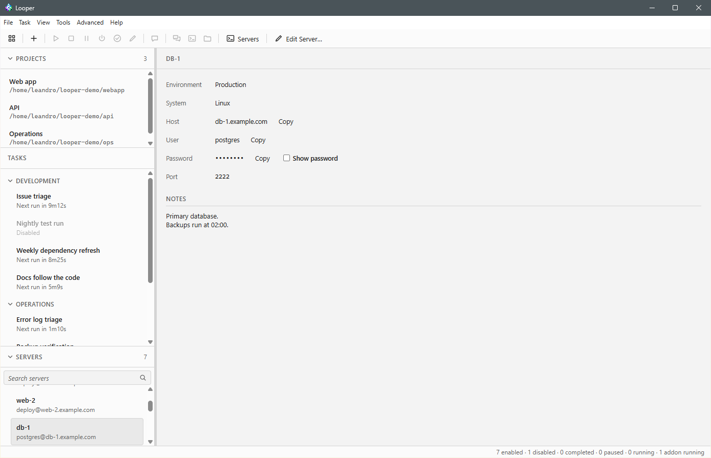
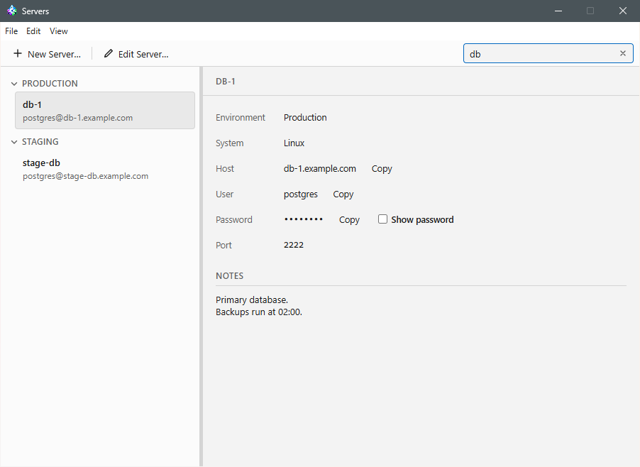

# Addons

An addon is another program that adds screens to Looper: a pane in the
sidebar, a screen in the main window when you select one of the pane's items,
and windows of its own. The program only describes what each screen holds
(fields, values, buttons). Looper draws it with its own controls, so addon
screens look and behave like the rest of Looper, and they follow along when
Looper's interface changes.

## Installing an addon

An addon comes with a `.looperaddon` file. Double-click it, drop it on the
Looper window, or use **Advanced → Addons… → Install…**. Looper asks first,
showing the addon's description, the panes, toolbar buttons and Tools menu
items it adds, how many tools' calls it changes the look of on the Chats
window's Now tab, and the command it runs, and installs it when you click
**Install**. For an addon that's already installed, the button says
**Replace** (another version) or **Reinstall** (the same version).

The command runs with your user account, the way a task's check does, so
install only addons you trust.

Looper starts every installed addon when it starts, and stops them when it
quits.

## Addon panes



Each pane an addon adds shows in the sidebar below the task list, in both the
single-list and the multiple-pane layout. Like the task panes, it has a header
you click to collapse it and a splitter above it you drag to resize it.
An addon can group a pane's items under headings, like task folders, that you
click to collapse; collapsed groups stay collapsed the next time.
Selecting an item shows its screen in the main window, and selecting a task
goes back to the task's detail. Right-clicking an item opens its menu, and
right-clicking the pane's header opens the pane's menu, which ends with
**Hide Pane**. Its check box in the **View** menu shows a hidden pane again.

When an addon stops on its own, its panes say so and show the end of what it
printed as it stopped, with a **Restart** button.

## The toolbar

An addon can add buttons to the main toolbar, after Looper's own, such as a
**Servers** button that opens the addon's Servers window. While one of an
addon's screens shows in the main window, that screen's buttons follow them,
such as **Edit Server…** for the selected server.

The View menu has a check box for each installed addon after **Toolbar**,
such as **Servers Toolbar** (the addon can give it another name), and
right-clicking the toolbar lists the same check boxes. Clearing one leaves all of that addon's buttons out of the main
toolbar. Its commands stay in its menus and its own windows.

## The Tools menu



An addon can also add items to the **Tools** menu, below Recycle Bin…. Each
item opens a window: either one of the addon's
screens, or one of its panes with the list on the left and the selected
item's screen on the right, the way the main window shows a task. A pane
window can have its own menu bar and toolbar, whose commands for an item act
on the selected one and are unavailable while nothing is selected. In a pane
window, right-clicking an item opens its menu and right-clicking the list's
empty space opens the pane's menu. Choosing the item again brings the open
window forward.

## The Addons window

**Advanced → Addons…** lists the installed addons with their status (Starting,
Running, or Stopped). Under the list, **Install…** picks a `.looperaddon`
file, **Edit…** changes how the selected addon runs (below), **Stop** stops
it, **Start** starts it again, **Restart** stops and starts it, and
**Remove** uninstalls it after asking. Below the buttons are the selected
addon's command, its panes, and why it stopped, if it stopped on its own.

### Changing how an addon runs

An addon runs in one of your environments from **Settings → Environments**,
the way tasks do, with that environment's WSL distro and shell. Its file says
whether its program is a WSL or a Windows program, and Looper starts it in
your default environment when that one runs programs of that kind, or else in
the first environment that does. When none does, the addon stays stopped and
says so.

**Edit…**, or double-clicking an addon, opens a window where you change how
your Looper runs it: the **Environment** (only the ones that run its kind of
program are listed), the **Command**, the **Working folder**, and the
**Environment variables** (`NAME=value`, separated by spaces). Use it when the
addon's program is in a different place on your computer, or when it needs a
setting of yours. **Save** restarts the addon with your settings. Looper keeps
them apart from the addon's file, so installing a new version doesn't undo
them, and **Restore Defaults** goes back to the file's own and the default
environment. The install dialog shows your settings when you have changed
them.

Looper remembers a stopped addon: it doesn't start the next time Looper
starts, and its panes, toolbar buttons and Tools menu items stay hidden, and
its windows close, until you start it again. The status bar counts the
running addons.

## Writing an addon

An addon is any program that reads JSON-RPC 2.0 requests from its stdin and
writes the responses to its stdout, one JSON message per line. Looper starts
it from the manifest, keeps it running, and closes its stdin when it stops
it. The addon should then exit, and Looper kills it if it hasn't exited
2 seconds later. Each line the addon writes to stderr goes to the engine log
as `addon <id> stderr: <line>`, up to 60 lines a minute, and the last lines
also show in the Stopped message. A stdout line that isn't JSON is skipped and
noted in the engine log.

### The manifest

```json
{
  "$type": "looper/addon",
  "$version": 1,
  "id": "servers",
  "name": "Servers",
  "version": "1.0.0",
  "description": "The servers you log in to",
  "run": {
    "on": "wsl",
    "command": ["node", "/home/me/servers-addon/addon.mjs"],
    "env": { "SERVERS_FILE": "/home/me/servers.json" }
  },
  "panes": [{ "id": "servers", "title": "Servers" }],
  "tools": [{ "id": "servers", "label": "Servers", "pane": "servers" }],
  "toolbar": [{ "id": "servers", "label": "Servers", "icon": "terminal", "tool": "servers" }]
}
```

| Field | Meaning |
|---|---|
| `$type`, `$version` | Always `looper/addon` and `1`. `$version` covers the manifest and the protocol. A Looper that doesn't know the version refuses the file and asks to be updated. |
| `id` | Letters, digits, `.`, `_`, `-`. Installing another file with the same id replaces the addon. |
| `name`, `version`, `description` | What the install dialog and the Addons window show. |
| `run.on` | `wsl` or `windows`: whether the program is a WSL or a Windows program. The user's environment decides the distro and shell. |
| `run.command` | The program and its arguments. A WSL command runs through the environment's shell, `bash -lic` unless the user changed it, as tasks do, so the PATH includes what `~/.bashrc` adds (nvm, bun). A Windows command must be an `.exe`. |
| `run.cwd`, `run.env` | Working directory and extra environment variables. |
| `${addonDir}` | In `run.command`, `run.cwd` and `run.env` values: the folder the `.looperaddon` file is installed from, as the side the addon runs on sees it (`/home/…` or `/mnt/c/…` in WSL). Ship the file next to your program and write `"command": ["node", "${addonDir}/addon.mjs"]`, and the addon runs wherever the user keeps your program. |
| `panes` | The sidebar panes, by id and title. |
| `tools` | Tools menu items: `{ id, label, pane }` opens a window with that pane and the selected item's screen, `{ id, label, view, params? }` a window with that screen. `width` and `height` size the window. Looper adds the "…" to the label. |
| `toolbar` | Buttons on the main toolbar, after Looper's own, there at all times: `{ id, label, icon?, tool? }`. With `tool`, the button opens that tool's window; without it, it sends a `click` event whose `source` is `{ toolbar: "main" }`. The buttons are unavailable while the addon isn't running. |
| `toolbarName` | The name in the View menu's "*name* Toolbar" check box for these buttons. Unset means the addon's `name`. |
| `toolCalls` | How calls to some tools show on the Now tab of the Chats window's activity pane (below). |

### Requests from Looper

| Method | Params | Result |
|---|---|---|
| `initialize` | `{ protocol: 1, looper, host }` | `{}`. Looper marks the addon as running once it answers. |
| `pane` | `{ pane }` | A pane's content (below). |
| `render` | `{ view, params }` | A screen (below). |
| `event` | an event (below) | `{ actions?, value?, values? }` |

An answer with `error: { message }` instead of `result` shows the message to
the user: in a dialog for an event, or in place of the screen or pane. Looper
waits 30 seconds for each answer.

The addon can also send the `refresh` notification (`{"jsonrpc": "2.0",
"method": "refresh"}`) at any time, and Looper asks for its panes and the
screens it shows again.

### Panes

```json
{
  "items": [
    {
      "id": "db-1",
      "label": "db-1",
      "description": "postgres@db-1.example.com",
      "group": "Production",
      "keywords": "Linux",
      "view": "server",
      "params": { "id": "db-1" },
      "menu": [
        { "id": "copy-host", "label": "Copy &Host" },
        { "separator": true },
        { "id": "edit", "label": "&Edit Server…", "enabled": true }
      ]
    }
  ],
  "search": { "placeholder": "Search servers" },
  "menu": [
    { "id": "show:all", "label": "&All", "checked": true, "radio": true },
    { "id": "show:linux", "label": "&Linux", "checked": false, "radio": true },
    { "separator": true },
    { "id": "new", "label": "&New Server…" }
  ],
  "empty": "No servers yet.",
  "toolbar": [
    { "id": "new", "label": "New Server…", "icon": "add" },
    { "id": "edit", "label": "Edit Server…", "icon": "edit", "needsItem": true }
  ],
  "menuBar": [
    { "label": "&File", "items": [{ "id": "new", "label": "&New Server…" }] },
    { "label": "&Edit", "items": [{ "id": "edit", "label": "&Edit Server…", "needsItem": true }] }
  ]
}
```

Each item is a row like a task's: `label`, and `description` as the line
under it. `dimmed: true` fades the row the way a disabled task's is. Items
with the same `group` show under a heading with that name, in the order the
groups first appear, and items without one come first. Selecting the item
renders its `view` with its `params` in the main window. Double-clicking it or
pressing Enter sends an `open` event. `menu` is the item's right-click menu,
and the pane's own `menu` is its header's. `toolbar` and `menuBar` show only
in a pane window opened from the Tools menu.

`search` adds a Search box, drawn and matched the way the Windows guidelines
describe an instant search, with no request to the addon:

- In the sidebar it sits at the top of the pane. In a pane window it's at the
  right of the toolbar, and Ctrl+E goes to it.
- `placeholder` is its prompt, such as "Search servers", and it defaults to
  "Type to search".
- The list filters as the user types. An item matches when any word typed
  starts a word of its `label`, `description`, `group` or `keywords`, in any
  case.
- While a search is on, the sidebar pane header shows "3 of 7", and every
  group with a match is open. The "x" in the box or Esc clears it, and
  focusing the box selects what was typed before.

### Menus and toolbars

A menu item is `{ id, label, enabled?, confirm?, needsItem?, checked?,
radio? }` or `{ separator: true }`. `&` in a label marks its access key, and
`&&` is a literal `&`. With `confirm`, Looper asks that question first.
`checked` draws a check mark next to the item while it's true, and with
`radio: true` a bullet instead, for one choice among the items around it.
Picking one sends the usual `menu` event, and the addon answers with a
`refresh` so the marks follow. A menu bar is a list of `{ label, items }`.

In a pane window, a menu-bar item or toolbar button with `needsItem` acts on
the selected item, and the event's `item` is that item. It's unavailable while
nothing is selected. When the selected item has a `menu`, the command follows
it: the entry with the same `id` gives its `enabled`, and with no such entry
the command is unavailable. So an item that leaves Copy 2FA Code out of its
menu also leaves it off in the menu bar. An item without a `menu` leaves every
`needsItem` command available.

A toolbar is a list of buttons `{ id, label, icon?, iconOnly?, disabled?,
confirm?, needsItem? }` and `{ separator: true }`. Each button shows its
`label`, after its `icon` when it has one. With `iconOnly`, it shows only its
icon, and the `label` is its tooltip. Keep it for commands people know by
their icon, such as Refresh. The icons are Looper's own: `add`, `edit`, `delete`, `copy`,
`refresh`, `open`, `folder`, `terminal`, `run`, `stop`, `pause`, `key`,
`lock`, `search` and `settings`. A click sends a `click` event with the
button's `id`.

### Screens

```json
{
  "title": "db-1",
  "toolbar": [{ "id": "edit", "label": "Edit Server…", "icon": "edit" }],
  "body": [
    { "type": "props", "items": [
      { "label": "Host", "value": "db-1.example.com", "copy": true },
      { "label": "Password", "secret": "password" },
      { "label": "Uptime", "value": "12 days", "note": "Checked 5 s ago" }
    ] },
    { "type": "section", "title": "Notes", "body": [{ "type": "text", "text": "Primary database.\nBackups run at 02:00." }] }
  ],
  "refreshSec": 5
}
```

`toolbar` adds its buttons to the window's toolbar while the screen shows: in
the main window after Looper's own buttons, in a pane window after the pane's,
and in a window the screen fills, in a toolbar of its own. `menuBar` becomes
the menu bar of a window the screen fills (one opened with `openWindow`, or a
Tools item with a `view`).

`body` is a list of nodes:

| Node | Fields | Drawn as |
|---|---|---|
| `props` | `items`: `{ label, value?, mono?, copy?, note?, secret? }` | Label and value rows, like a task's Status tab. `copy` adds a Copy button, and `note` is muted text at the end of the row. `secret` names a value the addon keeps: the row shows dots, selecting its Show check box sends a `reveal` event and shows the `value` it answers until the box is cleared, and Copy sends a `copy` event whose `value` goes to the clipboard without reaching the screen. |
| `text` | `text`, `muted?` | A paragraph. Line breaks in `text` show as line breaks. |
| `markdown` | `text` | Formatted text. |
| `infobar` | `title`, `message`, `button?` | An information bar. |
| `buttons` | `items`: buttons | A row of buttons. |
| `field` | `id`, `label`, `input`, `value?`, `options?`, `accept?`, `placeholder?`, `suffix?`, `required?`, `autofocus?` | An input. `input` is `text`, `password`, `textarea`, `number`, `checkbox`, `select` (with `options: [{ value, label }]`) or `file`. `suffix` is a unit shown inside the input. A `file` field is a path box with a **Browse…** button, and `accept: [{ label, extensions }]` (such as `{ "label": "CSV files", "extensions": ["csv"] }`) sets the kinds of file Browse… offers. Its value is the path as the addon sees it: a file picked on Windows reaches an addon in WSL as a `/mnt/c/...` path. |
| `row` | `items`: fields | Fields side by side. |
| `section` | `title`, `body` | A titled group of nodes. |
| `tabs` | `id`, `items`: `{ id, title, body }` | Looper's tabs, showing one tab's `body` at a time. In a window, top-level tabs go across the top of the window, and Ctrl+Tab moves between them. The selected tab stays selected when the screen is drawn again, and the fields on every tab keep their values. |
| `footer` | `primary`, `apply?` | In a window, its bottom bar: the primary button, Cancel (which closes the window), and the apply button. Enter clicks the primary button and Esc cancels. The primary button stays off while a `required` field is empty. |

A button is `{ id, label, primary?, danger?, disabled?, confirm? }`. With
`confirm`, Looper asks that question first, and No sends nothing.

Looper keeps what the user types in the fields while the screen is drawn
again, so an addon can send the same screen with new values in other nodes.
`refreshSec` draws the screen again that often while it shows, for a
countdown or a value that changes.

### Events

```json
{
  "source": { "view": "edit", "params": { "id": "db-1" } },
  "kind": "click",
  "id": "save",
  "values": { "name": "db-1", "host": "db-1.example.com" }
}
```

`source` is where the event came from: a screen (`{ view, params }`), a pane
(`{ pane }`), or a main-toolbar button (`{ toolbar: "main" }`). `kind` is one
of:

- `click`: a button or toolbar button, `id` is the button. From a pane
  window's toolbar, `item` is the selected item.
- `menu`: a menu item, `id` is the item. `item` is the pane item the menu was
  opened on, or in a pane window's menu bar, the selected one.
- `open`: a pane item was double-clicked or had Enter pressed, and `id` and
  `item` are that item.
- `reveal` or `copy`: a secret's Show check box or Copy button, `id` is the
  secret.

`values` has the screen's fields, by field id.

The answer can have:

- `value`: the secret, for `reveal` and `copy`.
- `values`: new values for the screen's fields, by field id.
- `actions`, carried out in order:

| Action | Fields | What it does |
|---|---|---|
| `openWindow` | `view`, `params?`, `title`, `width?`, `height?`, `modal?` | Opens a window showing that screen. It doesn't block the window it came from unless `modal` is set. |
| `closeWindow` | | Closes the window the event came from. |
| `refresh` | | Draws the addon's panes and screens again. |
| `message` | `kind` (`info`, `warning`, `error`), `message`, `detail?` | Shows a dialog. |
| `copy` | `text` | Copies the text to the clipboard. |
| `select` | `pane`, `item` | Selects a pane item, such as one just created, in the window the event came from, or in the window that opened it. |

### How tool calls show

The Now tab of the Chats window's activity pane shows the agent's tool calls.
An addon whose program the agent calls as a tool, such as an MCP server that
comes with it, can say how those calls show there, with `toolCalls` in the
manifest:

```json
"toolCalls": [
  { "tool": "mcp__servers__deploy", "title": "Deploy {server}", "params": ["server", "branch"], "result": "markdown" },
  { "tool": "mcp__servers__logs", "params": [], "result": "code", "language": "json" },
  { "tool": "mcp__servers__*", "result": { "view": "tool-call" } }
]
```

| Field | Meaning |
|---|---|
| `tool` | The tool's name as the agent calls it. An MCP server's tools are `mcp__<server>__<tool>`. A `*` at the end matches every name that starts with what comes before it. When several entries match, the one that names the tool wins, and then the longest `*` one. |
| `title` | The title above the call instead of the tool's name. `{name}` in it is the call's parameter of that name. |
| `params` | The parameters to list, in this order. Unset lists them all, and `[]` none. |
| `result` | How the result shows: `text` (as it is, in monospace), `markdown` (formatted), `code` (with line numbers and colors), `image` (the picture the result carries), `table` (a JSON list of objects as a table, a JSON object as name and value rows), or `{ "view": "<id>" }`, one of the addon's screens. Unset shows it the way Looper shows any tool's result. |
| `language` | With `"result": "code"`: the language to color it as, such as `typescript`, `json`, `python`, `bash`, `powershell`, `yaml`, `sql`, `xml` or `markdown`. Unset goes by the extension of the call's `file_path`. |

For a `view`, Looper asks for the screen with `render` and these params:
`{ tool, input, result, error }`, the tool's name, the call's parameters, the
result's text and whether the call failed. The screen shows under the
parameters without its title, toolbar or menu bar, and its buttons send events
as on any screen. While the addon isn't running, the result shows the way
Looper shows any tool's. An addon stopped in the Addons window changes no
tool's look.

### Ids and limits

Pane, item, view, button, menu item, field and secret ids use letters,
digits, `.`, `_`, `:` and `-`, and start with a letter or digit. The addon's
own `id` can't have `:`, because it names the manifest file. Windows are 320
to 2000 px wide and 200 to 1400 px tall, and `refreshSec` is at least 1.
`params` can be any JSON object, and Looper passes it back unchanged.

### When a reply doesn't fit

Looper checks every pane, screen and event answer. One that doesn't fit the
protocol shows instead of the screen or pane, or in a dialog for an event,
as "The addon sent a screen Looper can't show:" followed by the first wrong
fields, such as `body.0.type: Invalid discriminator value`. An addon that
exits shows "It exited with code N." and the last lines it wrote to stderr in
its panes and in the Addons window.

### A minimal addon

This Node addon has one pane, `notes`, with one item whose screen shows a
line of text. Its manifest has `"panes": [{ "id": "notes", "title": "Notes" }]`.

```js
import { createInterface } from 'node:readline';

const notes = [{ id: 'n1', title: 'First note', text: 'Hello from an addon.' }];
const send = (msg) => process.stdout.write(`${JSON.stringify({ jsonrpc: '2.0', ...msg })}\n`);

const methods = {
  initialize: () => ({}),
  pane: () => ({ items: notes.map((n) => ({ id: n.id, label: n.title, view: 'note', params: { id: n.id } })) }),
  render: ({ params }) => {
    const n = notes.find((x) => x.id === params.id);
    return { title: n.title, body: [{ type: 'text', text: n.text }] };
  },
  event: () => ({ actions: [{ type: 'message', kind: 'info', message: 'Clicked.' }] }),
};

createInterface({ input: process.stdin })
  .on('line', async (line) => {
    const msg = JSON.parse(line);
    try {
      send({ id: msg.id, result: await methods[msg.method](msg.params ?? {}) });
    } catch (e) {
      send({ id: msg.id, error: { code: 1, message: e.message } });
    }
  })
  .on('close', () => process.exit(0));
```

An addon whose answers take a while should finish the ones still pending
before it exits on close, by counting the requests it hasn't answered and
exiting when the count reaches zero.

### Testing an addon

Outside Looper, pipe requests into the addon, one per line, and read its
answers:

```sh
printf '%s\n' \
  '{"jsonrpc":"2.0","id":1,"method":"initialize","params":{"protocol":1}}' \
  '{"jsonrpc":"2.0","id":2,"method":"pane","params":{"pane":"notes"}}' \
  | node addon.mjs
```

In Looper, install the manifest, then use **Advanced → Addons… → Restart** after
each change to the addon's code, because Looper keeps the process it started.
Reinstalling the manifest is only needed when the manifest itself changes.
**Advanced → Engine Log** shows when each addon starts and how long that took,
when it stops, any stdout line Looper skipped, and the addon's stderr. Its
View menu can list one addon's lines only. A request that takes 250 ms or more
gets a line, and so does one that fails, times out, or gets a reply Looper
can't show:

```
addon servers: #41 render server 1830 ms (2 in flight)
addon servers: #42 event click save 412 ms, failed: The disk is full.
addon servers: render server drawn after 1910 ms
```

`#41` is the JSON-RPC request id, so start your own stderr lines with it to
line them up with Looper's. "In flight" counts the requests still waiting for
an answer when this one was sent. "Drawn after" is a screen that took more
than 500 ms from being asked for to showing. Lines never include request
params, field values, or replies, since those can hold passwords.
