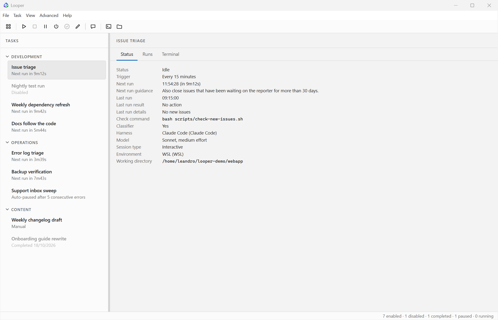
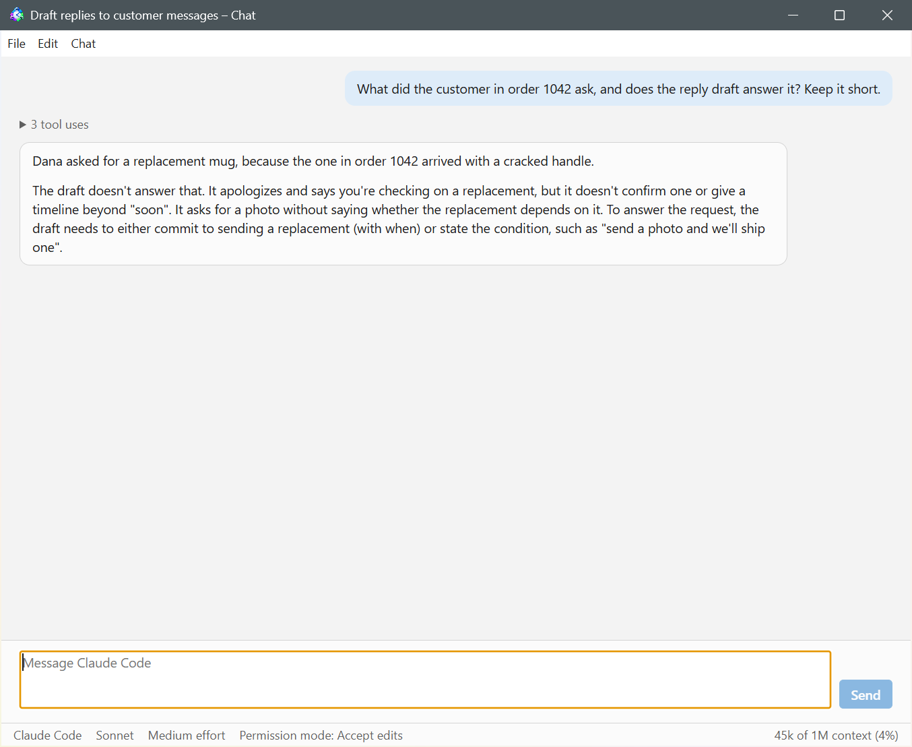
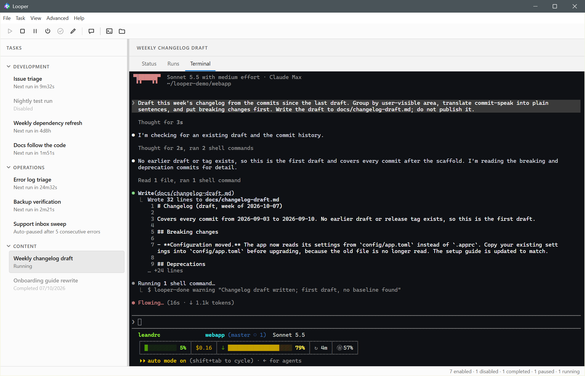
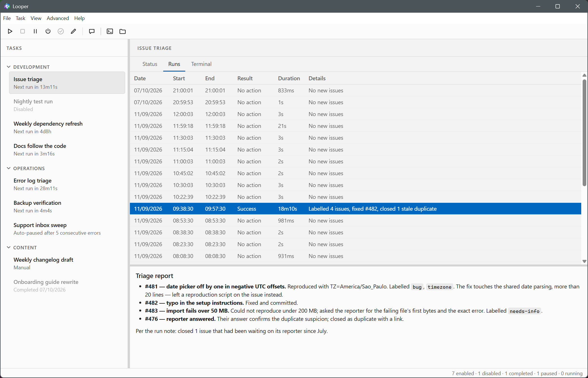
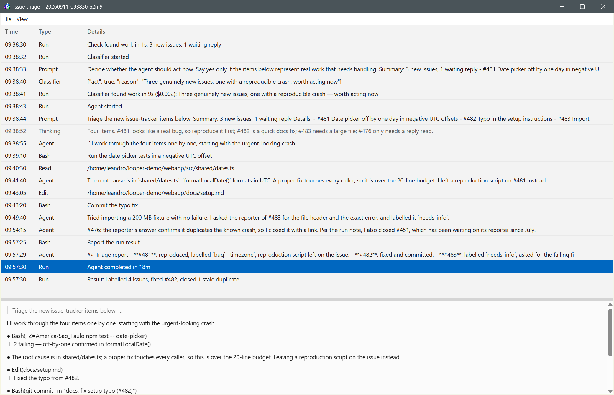
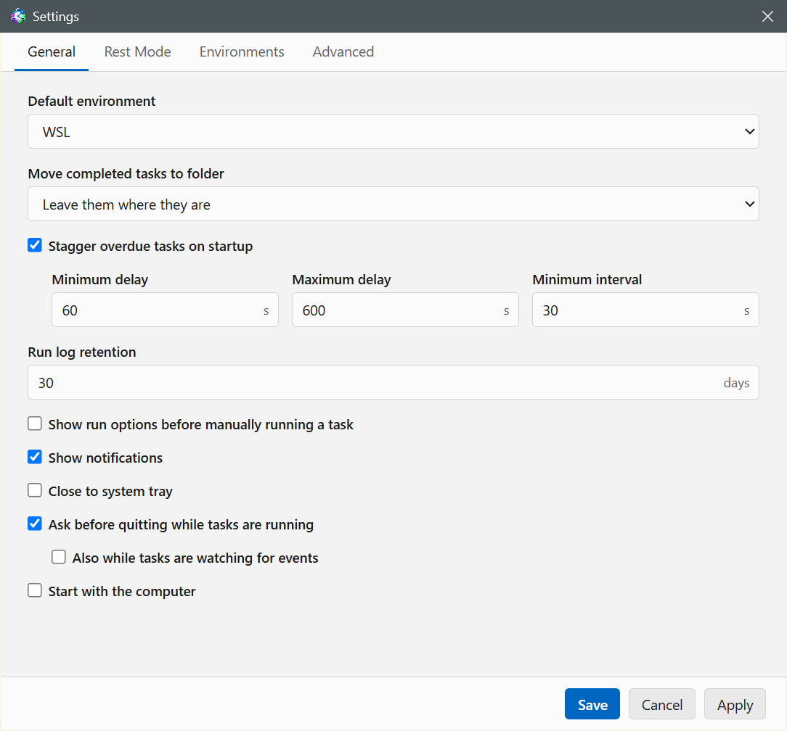

# Monitoring and controlling tasks

## The main window

The sidebar lists your tasks by name, with a status line under each one:
what it's doing right now if active ("Needs attention" while a run is held
for you), otherwise a next-run countdown, "Not scheduled", "Manual", its
paused reason, "Disabled", or "Completed" with the date it finished for good.
A watcher task reads "Watching" while its watcher command is up, "Watcher
restarting" while Looper waits to restart it, and "Idle" outside its active
hours. Disabled and completed tasks are
shown faded. Selecting a task opens its detail pane with three tabs — Status,
Runs, Terminal — plus a status bar at the bottom counting
enabled, disabled, completed, paused, and running tasks. While Rest Mode is
on, the status bar also shows what it's doing (see [Rest Mode](#rest-mode)).

Double-clicking a task opens its Edit Task window.

## The dashboard

With no task selected, the detail pane shows the dashboard. It's what the
window opens on, and you get back to it with the Dashboard button at the
start of the toolbar, **View → Dashboard**, or a click on the empty space
below the task list.

**Needs attention** lists each task that needs you, errors first, with the
problem and when its run started. A task is listed when:

- a run is waiting for you (warning icon), until you answer it in the
  Terminal tab;
- it was auto-paused after too many consecutive errors, or because its
  watcher kept crashing (error icon);
- its last run ended in an error, a time-out or an idle time-out (error
  icon), or a warning (warning icon), until a later run ends well.

Disabled and completed tasks aren't listed.

**Running now** lists every run in progress, oldest first: the task, its
step (Checking, Classifying, Running agent, or Waiting for you), what
triggered it (Schedule, Manual, or Event), when it started, and how long it
has been going.

Clicking a row picks it, and the toolbar, the Task menu and the row's
right-click menu then act on that task. Stop Task stops that row's run.
Double-clicking a row, or pressing Enter, selects the task and opens its
Terminal tab, or its Runs tab for a failed run.

Tasks and folders can be reordered by dragging them; the order is saved.
Dropping a task on another task inserts it there (joining that task's
folder, if any); dropping it on the middle of a folder header moves it into
that folder; dropping it on the empty space below the list moves it to the
end of the top level. Tasks and folders mix freely at the top level: the
top edge of a folder header drops before the folder, and the bottom edge of
a folder's last row (a full-width line, instead of the indented in-folder
one) drops after the folder. Dragging a folder header moves the whole
folder.

The Status tab lists the task's current state as plain fields: Status,
Completed (date and reason, when the task is finished for good), Trigger,
Watcher command (watcher tasks only), Next run, Stops running on (when the
trigger has an end date), Next run guidance (when a one-off note is set), Last
run, Last run result, Last run details, Check command, Classifier (Yes/No),
Harness, Model, Session type, Environment, and Working directory. For a
watcher task, Next run reads "When the watcher fires" while it's watching;
outside its active hours, Status reads Idle and Next run shows when watching
starts again.

The View menu opens the [dashboard](#the-dashboard) and controls what the
window shows: a Standard or Compact task
list (Compact drops the status line), whether disabled, completed, scheduled,
manual, and watcher tasks are listed at all, whether
folders open automatically (folders start open, and opening one opens its
whole subtree; unchecked, folders start closed), whether every task's Runs
tab hides runs with no action (Task Logs → Hide Runs with No Action) and the
[chats](#chats) and [terminal sessions](#terminal-sessions) you started (Task
Logs → Hide Chats and Terminals), and whether the toolbar and status bar
themselves are shown.

The Advanced menu has Update Models… (see
[Models](environments.md#models)), Engine Log (described below), Open Data
Directory, which opens the [data directory](cli-and-automation.md#the-data-directory)
in your file manager, and Reload UI. **Help → Instructions** (F1) opens this
guide in its own window, and Help → About Looper shows the version.

## The toolbar

The toolbar acts on the selected task, or on the row picked on the
dashboard. Buttons, left to right, with their tooltips:

| Button | Tooltip | Shortcut |
|---|---|---|
| Grid | Dashboard (stays pressed while the dashboard shows) | — |
| Run | Run Now | F5 |
| Stop | Stop Task | Shift+F5 |
| Pause/Resume | Pause / Resume | Ctrl+P |
| Power | Enable / Disable | — |
| Check | Complete / Reopen | — |
| Edit | Edit Task | Ctrl+E |
| Guidance | Add Guidance for Next Run / Edit Guidance for Next Run | — |
| Terminal | Open Project in Terminal | Ctrl+T |
| Folder | Open Working Directory | — |

Running Now on a disabled or completed task asks '"<task name>" is disabled.
Run it anyway?' first — the run happens, and the task goes straight back to
being disabled or completed afterwards. With **Settings → General → Show run
options before manually running a task** on, Run Now opens the Run Options
window instead of starting the run right away (see
[run options](how-a-run-works.md#run-options-for-a-manual-run)). When several
runs of the task are going at once, Stop Task stops the one picked in the
Terminal tab's run selector (the newest by default). Pause/Resume, Enable/Disable and
Complete/Reopen swap their tooltip and icon
depending on the task's current state; Pause and Enable/Disable are greyed
out for a completed task, which is parked until you reopen it. Complete is
greyed out unless the task's **Allow this task to be marked completed**
option is on (Reopen always works), and asks for confirmation, since the task
moves to the [Recycle Bin](#the-recycle-bin) once its retention runs out.
"Open Project in Terminal" opens a terminal session with the task's
environment, working directory, and harness ready to go (model and
permission mode included, no prompt) — a different thing from the in-app
Terminal tab described below. See [terminal sessions](#terminal-sessions)
for where it opens.

## Terminal sessions

Open Project in Terminal and Continue in Terminal (see [continuing a
run](how-a-run-works.md)) open a terminal session where
**Settings → General → Open terminal sessions in** says:

- **Looper** (the default) opens a Looper terminal window titled with the
  task's name. When the harness exits, the window shows "session ended".
  Closing the window ends the session, and so does quitting Looper, which
  asks first while a session is still running, whatever **Ask before
  quitting while tasks are running** is set to.
- **Default terminal** opens a window of the system's terminal instead. On
  Windows that's the default terminal application set in Windows (Settings
  → System → For developers → Terminal); on Linux, `$TERMINAL` or the first
  common terminal found; on macOS, Terminal. That window doesn't depend on
  Looper and stays open when Looper quits.

With Claude Code or Codex, a session in a Looper terminal window becomes a
run of the task when the agent finishes its first turn. It shows in the Runs
tab with **Terminal** as its result and its first message as the details,
and it has no time limits and no dashboard row. Each time a window on it
opens and closes adds a line to the run's records ("Terminal opened",
"Terminal closed after 12m"). A session closed before the agent's first turn
leaves nothing behind. Sessions in the system's terminal aren't recorded,
because Looper can't tell when they end, and neither are a custom harness's.

The run window shows the session's conversation, and the run's right-click
menu has the Continue items. **Continue in Terminal** opens the same run
again on its conversation. As with [chats](#chats), a conversation has one
terminal session: Continue in Terminal on a run whose conversation a terminal
session already went on with opens that session's run, and a Looper terminal
window that's open comes to the front.

Looper learns about each finished turn from hooks it passes to the harness:
Claude Code's SessionStart and Stop hooks, and Codex's `notify` setting.
Because that setting is passed with `-c`, Codex shows "⚠ 1 warning" in its
status line, saying it runs without its shared background server; the
session works the same.

In a Looper terminal window you can attach files: drop them on the window,
paste a copied screenshot with Ctrl+V, or right-click and choose **Attach
Files…** (the right-click menu also has Copy and Paste). Looper saves a copy
in the task's [attachments](#attachments) and pastes its path where the
cursor is. Claude Code and Codex turn a pasted image path into an image
attachment; any other file is a path the agent can read.

## Chats

**Open Project in Chat** (Task menu, or right-click a task) and **Continue
in Chat** (right-click a run in the Runs tab, or the run window's File menu)
open the task's harness in a Looper chat window, as messages instead of a
terminal. It starts with the task's own harness, model, effort, permission
mode and arguments. Continue in Chat shows the run's conversation above the
new messages and goes on from where the run left off.

Once you send the first message, the chat is a run of the task: it shows in
the Runs tab with **Chat** as its result and its first message as the
details, and each time its window opens and closes adds a line to the run's
records. It has no time limits and no dashboard row. Double-click it for the
run window, and right-click it for the same Continue items as any run.
Continue in Chat opens the chat again with its conversation and settings,
and goes on from where it ended. A conversation has one chat at a time: if a
chat already went on with a run's conversation, Continue in Chat on that run
opens that chat, and a chat that's open comes to the front. While a chat or
a Looper terminal window holds a conversation, the runs whose conversation it
is offer only the Continue item that brings that window forward, so nothing
else writes to the conversation at the same time. A chat closed without a
message sent leaves nothing behind. Chats and terminal sessions are deleted
by **Run log retention** (Settings → General), like other runs, and **View →
Task Logs → Hide Chats and Terminals** hides them from the Runs tab.

Enter sends the message (Shift+Enter starts a new line). In an empty message
box, Up brings back the messages you sent, newest first, and Down goes back
toward your draft. The status bar at the bottom shows the harness, model,
effort and permission mode, and how much of the model's context the
conversation fills (after the agent's first reply).

The window's File menu has Attach Files… (Ctrl+O), Save as Markdown… (Ctrl+S,
with the same export options as the run window), Open Working Directory, and
Close (Ctrl+W).

The Edit menu has Undo, Redo, Cut, Copy, Paste, Select All, and **Find…**
(Ctrl+F), which opens a find bar above the conversation. Enter or F3 goes to
the next match, Shift+Enter or Shift+F3 to the previous one, and Esc closes
the bar. Text inside a collapsed tool group or thinking block isn't searched.

The Chat menu has **Stop** (Esc), which ends the agent's turn while it works
(the next message goes on with the same conversation), and the **Model**,
**Effort** and **Permission Mode** submenus. They change this chat only, and
the task keeps its own settings. A new permission mode applies right away,
even mid-turn. With Claude Code, a new model or effort, or switching to
Bypass, restarts the session on the same conversation, so those wait until the
agent finishes its turn. With Codex, every change applies from the next
message.

Right-click a message for Copy (the selected text) and Copy Message; on a tool
call, Copy Input and Copy Result, plus Open File and Copy Path when it worked
on a file. On a message you sent, **Edit as New Message** puts its text and
files back in the message box so you can change them and send them again. The
earlier message stays in the conversation.

**Fork from Here** (right-click a message) opens a new chat whose conversation
is this one up to that message; this chat goes on unchanged. On the agent's
message, the new chat's conversation ends with it. On a message you sent, it
ends just before it, and the message waits in the new chat's message box, so
you can change it and send it on the other branch. Codex can only fork where
the agent ended a turn, so with Codex the item is on the agent's last message
of each turn (and on your messages), and not while the turn is running. The
new chat becomes a run of its own once you send a message.

With Claude Code, a tool call that the task's permission mode would ask about
shows in the chat with **Allow** and **Deny**, and the agent waits for your
answer. Codex can't ask for permission in a chat, so it does only what the
task's permission mode allows; the window says so at the top. The agent's
clarifying-question form isn't available in a chat, so it asks in the
conversation instead.

To attach files, drop them on the window, paste with Ctrl+V, or use **File →
Attach Files…**. They're listed under the message box until you send them, each
with a Remove link. An image (PNG, JPEG, GIF or WebP) goes to the agent inside
the message, so it sees it at once; any other file, or an image over 3.75 MB,
goes as a path the agent reads itself. In the conversation, images show as
thumbnails and other files by name, and clicking one opens it in its default
app.

Closing a chat window while the agent is working or waiting for your answer
asks first, and so does quitting Looper.

## Attachments

Files attached in a chat or a Looper terminal window are copied into the
task's data folder (`tasks/<task id>/attachments` in the [data
directory](cli-and-automation.md#the-data-directory)), so they stay readable
after you move or delete the original. They're deleted by **Run log
retention**, like the run folders.

## The context menu

Right-clicking a task in the sidebar selects it and opens a context menu
with the same actions as the toolbar, plus a few more: Run Now, Stop Task,
Pause/Resume, Enable/Disable, Complete/Reopen, Edit Task…, [Edit with
Agent…](task-builder.md), [Version History…](tasks.md#version-history),
Delete Task, Edit/Add Guidance for Next Run…, Clear Guidance, Move to
Folder…, Clear Run History…, Open Project in Terminal, Open Project in
[Chat](#chats), and Open Working Directory.

## The Recycle Bin

Delete Task moves the task to the Recycle Bin: it stops (a run in flight is
stopped, and only then does Delete ask first), never runs again, and leaves
the task list. Deleting a folder with **Also delete tasks inside** checked
does the same to each of its tasks. **File → Recycle Bin…** opens a window
listing the deleted tasks, most recently deleted first. **Restore** puts the
selected task back as it was, in its folder if that still exists. It can't
be restored while another task has its id, or when its environment or
harness was removed in the meantime; the error says which. **Delete** removes
it for good, and **Empty Recycle Bin** removes every task in the bin. Both
ask first. Right-clicking a task in the list offers Restore and Delete too.

A task stays in the Recycle Bin for **Settings → Advanced → Delete tasks in
the Recycle Bin after** (30 days by default), then is deleted for good with
its run history. Completed tasks reach the bin on their own, through the
completed-task retention described under
[the engine log window](#the-engine-log-window). While a task is in the bin,
its run history is pruned by **Run log retention** like any other task's.

## Folders

Tasks can be organized into folders, and folders nest without a depth
limit. **File → New Folder…** creates one, as does right-clicking the empty
space below the task list (or the "Tasks" title above it); the window has a
Parent folder field (blank = top level). Folders show as
headers in the sidebar; clicking a header collapses or expands the folder
(a collapsed header shows the task count of its whole subtree).

**Settings → General → Move completed tasks to folder** picks one folder
every task is filed into as it completes ("Leave them where they are" by
default); reopening a task leaves it there.

A task moves into a folder by dragging it there, or with **Move to
Folder…** — on the task's context menu and the Task menu — which opens a
window listing the folder tree (with a blank top row to move it back
out) and a field to create a new folder on the spot. Dragging one folder
onto the middle of another nests it there.

Right-clicking a folder header opens the folder's own menu, acting on every
task in it — nested folders included:

- **Run All Now** — runs each enabled task that isn't already at its
  Simultaneous runs cap. It never opens the Run Options window.
- **Pause All / Resume All** — pauses every task that isn't disabled or
  completed / resumes every paused one.
- **Enable All / Disable All**
- **Add Guidance for Next Runs…** — opens a guidance window applied to all
  tasks in the folder's subtree (saving empty text clears their notes).
- **New Subfolder…** — opens the New Folder window with this folder
  preselected as the parent.
- **Rename Folder…**
- **Delete Folder** — asks for confirmation; a checkbox on the dialog also
  deletes everything inside (tasks and nested folders). Left unchecked, the
  folder's contents move up to its parent.

## The terminal tab

The Terminal tab is a live view of the task's harness sessions — a real
terminal (xterm) you can watch and type into while a run is in progress.
Before any run it shows "No agent session for this task yet. Output appears
here when one starts." Each new run resets the view with a `── run <id> ──`
marker; within one run the classifier session (when configured) shows first,
closes with `── session ended ──`, and the agent session continues below.
When a task's "Simultaneous runs" setting lets more than one run be in
flight at once, a plain dropdown appears above the console listing each run
by id and state, so you can pick which one to watch and type into; with one
run in flight (or none) the dropdown is hidden and the tab just follows that
run.

For a **headless** session the same tab still shows the streamed output, but
there's nothing to type into — the process reads no input, so keystrokes go
nowhere. An interactive classifier, like an interactive agent, accepts input.

If the agent finishes a turn without signaling and the task is set to hold,
a banner appears: "The agent finished a turn without calling `looper-done`
and this task is set to hold. Type into the terminal to continue it, or
press Stop Task (Shift+F5)."

## The runs tab

The Runs tab lists every past run of the task as a table: Date, Start,
End, Result, Duration, Version (the task's [version](tasks.md#version-history)
when the run started), Details. Each row is one full run (check, classify,
and agent steps collapsed together, showing the most significant result);
a run still in progress shows Running in the Result column. A
[chat](#chats) or [terminal session](#terminal-sessions) you started shows as
Chat or Terminal, with its first message as the details.
Selecting a row shows that run's final report below in a resizable split
pane. Double-clicking a row, pressing Enter on it, or right-clicking it and
choosing "Open" opens the run window described below. The
context menu also offers "Copy Details", "Send Guidance…" (while the run's agent is going; see
[guidance for a run in progress](how-a-run-works.md#guidance-for-a-run-in-progress)),
"Continue in Terminal", "Continue in Chat" and "Continue with Guidance…" (for
a finished Claude Code or Codex run; see [continuing a finished run](how-a-run-works.md#continuing-a-finished-run)),
"Open Run Folder", and "Copy Run Folder Path". Ctrl+C copies the selected
run's report, or its details text when it has no report.

## The run window

The run window shows one run as a single timeline: the run's own steps
and its conversation, read straight from the harness's own session
transcripts (Claude Code and Codex harnesses only — custom harnesses record
no transcript, so their runs show only the steps). While the run is in
progress the window updates live. Its title is the task's name and the run
id.

Each row is one step, message, or tool call — Time, Type, Details — where
Type is Run, Prompt, Guidance, Agent, Classifier, Thinking, or the
tool's name. Run rows are the run's steps: the watcher events that started
it, the check result ("Check found work", "Check found nothing to do"), steps
the Run Options window skipped, the classifier and agent starting and ending
("Agent completed in 5m10s", with cost in dollars when the harness reports
it), guidance being sent and delivered, and the final result; for a chat or
terminal session, each time its window opened and closed ("Chat closed after
4m"). When the run had a classifier, its
conversation sits between its start and end rows, with its replies typed as
**Classifier**. Selecting a Run row shows that step's output below: the
agent's end row shows the run's terminal output, cleaned of ANSI codes and,
for headless runs, pretty-printed if it looks like JSON.

The Type column can be resized by dragging its header edge (the width is
remembered; double-click the edge to reset it). Clicking a message row
shows its full content in the split pane below: prompts and agent replies
render as Markdown, thinking as plain text, and tool calls as Input and
Result tabs (opening on Result once the tool has finished). Several tools
get tailored renders: Edit shows the change as a red/green diff, Bash
shows the command as a terminal block and its output with escape codes
stripped, Read results get a line-number gutter, TodoWrite renders as a
checklist, Task shows its prompt and the subagent's report as Markdown,
web tools link their URL, file searches list one file per line
(right-clickable to open), and JSON results render as a collapsible tree. While the run
is live the table refreshes every two seconds and follows the newest
message unless you've scrolled up. While the run's agent is going, a box
under the conversation sends it guidance (Send, or Ctrl+Enter); guidance it
hasn't picked up yet shows as a muted "Waiting for the agent" row.

Right-clicking a row offers Copy Content, and on rows for file tools
(Read, Edit, Write) also Open File and Copy Path; on Task rows, Open
Subagent Conversation.

The window's menu bar has a File menu (Save as Markdown…, Open Output File,
Continue in Terminal, Continue in Chat, Continue with Guidance…, Open Run
Folder, Copy Run Folder Path, Open Working Directory) and a View menu. Save as Markdown… (Ctrl+S) asks for a file name,
then opens an Export Options window with Include thinking, Include tool
usage, and No formatting (plain text); it saves the conversation without the
Run rows. View starts with Raw Messages — every
transcript record shown verbatim as pretty-printed JSON, nothing skipped —
and Raw Agent Output, which switches the agent's end row between the
cleaned output and the untouched raw terminal capture. Auto Scroll (off by
default) keeps the newest row selected: while the last row is selected, each
new row takes the selection and scrolls into view, and selecting an earlier
row stops that until you select the last row again. Then View filters what
the table lists: Show Run Log (the Run rows), Show Messages, Show Thinking,
Show Tool Usage, and Show Subagents (all on by default), plus Filter… (Ctrl+F),
which opens a small modal Filter window — only rows whose content matches
stay visible, the menu item shows a checkmark while a filter is active,
and the window's Clear Filter button removes it. Ctrl+Up and Ctrl+Down
jump between prompt and guidance rows.

When a tool result is an image (a Read of a screenshot, for example), the
Result tab shows the image itself, fitted to the pane. Double-clicking the
image or its row opens it in an image window with zoom controls (−, +, and
an editable percentage; it opens fitted to the window).

When the agent delegates work with the Task tool, that row can be opened as
its own conversation: double-click it, or use the "Open Subagent
Conversation" button in its detail pane. The subagent window is the same
rows-plus-panel view without the Run rows, and also updates live. It has no
guidance box, and its File menu has only Save as Markdown…, Open Run Folder,
Copy Run Folder Path, and Open Working Directory. The link becomes available once
the subagent has reported back to the parent.

Messages come from the transcript files under the harness's own data
directory (Claude Code's transcript JSONL, Codex's rollout files), so they
live and die with it: transcripts cleaned up by the harness (Claude Code:
30 days by default) show "The session transcript is no longer available."
Custom harnesses record no transcript, so their runs have no messages.
Codex runs show thinking rows only when the harness is configured to emit
reasoning summaries; see [Harnesses](environments.md#harnesses).

## The engine log window

**Advanced → Engine Log** opens a window listing the engine's own
diagnostic log as a table (Date, Time, Level, Message), refreshed every two
seconds; selecting a row shows its full message below. Entries older than
**Settings → Advanced → Engine log retention** (default 10 days) are pruned
automatically. This is separate from the tasks' run history, which
**Settings → General → Run log retention** prunes (default 30 days).

**Settings → Advanced → Move completed tasks to the Recycle Bin** (on by
default, after 10 days) moves each completed task to the
[Recycle Bin](#the-recycle-bin) once it has been completed that long. Turn
the checkbox off to keep completed tasks in the task list. A completed task
with a run in flight is left for the next sweep. The sweep, and the one that
empties the Recycle Bin of tasks past its retention, runs at startup and
hourly.

## System notifications

Looper can show a system toast for several points in a task's cycle: a run
starting, the agent starting, the agent holding for input, the task
auto-pausing, a usage limit being hit, the task completing, and the task
ending (with a configurable severity threshold). Each task chooses which of these it sends
on its Notifications tab — see [the task editor](tasks.md) for the field
list; by default only errors and warnings at the end of a run notify, and a
run that failed only because the computer was offline stays silent unless
the task's "Include network errors" option is on. A run that failed only
because WSL couldn't start a step stays silent the same way unless "Include
environment errors" is on.

A master switch lives in **Settings → General → Show notifications**, and
the same toggle is available from the tray menu as "Enable Notifications" /
"Disable Notifications". Clicking a toast opens the task: for a live run
(run started, agent started, held) it opens the Terminal tab. For a run that
ended with an error or a warning, or that auto-paused its task, it opens the
[run window](#the-run-window) with the run's report row selected (or its
last step, when the run has no report). Any other finished cycle (end, usage
limit, completed) opens the Runs tab with that run selected. A toast clicked
later from the Windows notification center still works, as long as Looper
hasn't been closed since it showed the toast. No toast fires while any Looper window is focused.

## Rest Mode

Rest Mode (Windows only) puts the computer to sleep between runs and wakes
it for the next one, so an overnight schedule doesn't keep the machine on.
**File → Start Rest Mode** (also on the tray menu) turns it on; the same
item becomes **Stop Rest Mode** while it's on, and the status bar shows what
it's doing.

While on, Looper owns the sleep policy: it keeps the computer awake while
any task is checking, classifying, or running, and once every task has been
quiet for the **Wait before sleeping** grace period it registers a wake
timer for the next scheduled run and suspends the computer. The wake is
never earlier than **Minimum sleep**, counted from the moment the computer
goes to sleep — a task on a 5-minute schedule under a 30-minute minimum
effectively runs about every 30 minutes, since slots that pass while asleep
are skipped and the task simply runs once on wake. With nothing scheduled
at all, the computer sleeps without a wake timer.

A held run does not keep the computer awake: it's a parked session waiting
for you, and it is still there after the next wake.

Waking the computer yourself (keyboard, power button, lid) turns Rest Mode
off, so it won't put the machine back to sleep under you — a toast says so.
Uncheck **Turn off when the computer is woken manually** in Settings to
keep it on across manual wakes instead. Turning Rest Mode on while wake
timers are disabled in Windows' power options (common on battery) shows a
warning first: the computer would sleep but never wake for the schedule.

The three settings are on the **Settings → Rest Mode** tab, which only
appears on Windows. Whether Rest
Mode is on is not remembered across restarts — a fresh Looper always starts
with it off.

The status bar shows the phase: "Rest Mode — waiting for tasks to finish",
"Rest Mode — sleeping in N s" during the grace period, and "Rest Mode —
sleeping until HH:MM" once the wake timer is set.

A sleeping computer drops every [Remote Control](#remote-control) session,
so **Start Rest Mode** is disabled while Remote Control is on, and starting
Remote Control turns Rest Mode off.

## Remote Control

Remote Control keeps Claude Code sessions open on this computer for the
Claude app (claude.ai/code or the mobile app), so you can start and steer
work while you're away. Each session is an interactive Claude Code session
started with `--remote-control`, and it shows in the app's session list under
its name. Only Claude Code harnesses can run them, and you need to be signed
in to Claude Code with a Claude subscription.

**Advanced → Remote Control → Start Remote Control** turns it on for this
run of Looper; the same item becomes **Stop Remote Control**, which ends
every one of its sessions (it asks first while a conversation has had a
message). Quitting Looper ends them too. Check **Start with Looper** in
**Advanced → Remote Control → Settings…** to turn it on whenever Looper
starts.

The settings window has two lists:

- **Helpers** are conversations whose only job is to start sessions. Ask a
  helper, for example, "open a session in the looper repo", and it runs
  `looper-remote open`, which starts a new session there and answers with
  its name and link, even when the folder is the helper's own. `looper-remote
  list` shows the projects and tasks set up in Looper, and `looper-remote
  recent` the folders where Claude Code sessions ran lately (from Claude
  Code's own record of folders), newest first; any other folder works by its
  path. A helper runs apart from your Claude Code setup and the folder's: no
  settings files, CLAUDE.md, skills or MCP servers, only the Bash tool, and
  only `ls` and `looper-remote` may run (anything else is refused without a
  prompt). Looper gives it its instructions, and **Instructions** in its
  editor adds your own, for example how it should reply. A helper that has
  had no message for **Restart when idle for** (10 min by default) is
  replaced by a fresh, empty one, so the next request starts clean. A helper
  is never replaced while it's working.
- **Projects** are folders where a conversation is always open: once it
  ends, another one opens. **Add Task…** picks a task: its session is the
  one Open Project in Terminal starts, with the task's environment, folder,
  model, effort, permission mode and variables. Its editor switches it to
  another task, and its **Name** names the session in the Claude app (empty:
  the task's name). **Add Folder…** sets these yourself.

A project or helper that can't get a session says why under its name in the
list, for example a task that was deleted, or Claude Code exiting right
after it starts (Looper stops trying after three times in a row, until the
entry changes or Remote Control starts again).

**Advanced → Remote Control → Conversations…** lists the conversations, open
ones first, with their state: waiting for a message, working, idle, or
ended. Opening an open conversation shows it in a Looper terminal window,
where you can go on at the computer; closing that window leaves the session
running. Opening an ended one shows its run window. The right-click menu has
**Open in Browser** and **Copy Link** for the session's claude.ai page, and
**Stop** to end it. Conversations are recorded as runs, like [terminal
sessions](#terminal-sessions), so a task project's conversations also show
in the task's Runs tab.

## The tray icon and close-to-tray

Looper keeps a tray icon running whenever the app is open. Double-clicking
it shows the main window; right-clicking it opens a menu with Show Looper,
Enable/Disable Notifications, Start/Stop Rest Mode (Windows only), and Quit.

By default, closing the main window quits Looper — and stops any running
agents. Turning on **Settings → General → Close to system tray** changes
that: closing the window just hides it, and the engine (and any running
tasks) keeps going in the background. `looper --hidden` starts straight
into the tray without opening the window, which is also what **Settings →
General → Start with the computer** registers as a login item.

Quitting while a task is running (window close, File → Exit, or the tray's
Quit) asks first, because it stops those runs. **Settings → General → Ask
before quitting while tasks are running** turns that question off. Its
sub-option **Also while tasks are watching for events** (off by default)
asks as well when tasks with an events trigger have their watcher up, since
quitting stops watching until Looper starts again.

## Settings

**File → Settings…** (Ctrl+,) opens a modal Settings window with four tabs:
General, Rest Mode (Windows only), Environments, and Advanced. Save writes
the General, Rest Mode, and Advanced fields; the Environments list applies
each change as soon as its own editor window saves.

On the General tab:

- **Default environment** is the environment a new task starts on.
- **Move completed tasks to folder** is described under [Folders](#folders).
- **Stagger overdue tasks on startup** (on by default) spreads out the runs
  Looper owes at startup. Each enabled scheduled task that is overdue (a slot
  passed since its last run, or it has never run) runs once, after a random
  delay between **Minimum delay** (60 s) and **Maximum delay** (600 s), with
  at least **Minimum interval** (30 s) between two of them. Turned off,
  overdue tasks start one second apart.
- **Run log retention** (30 days) sets how long run records and run folders
  are kept.
- **Open terminal sessions in** picks Looper (default) or Default terminal
  for [terminal sessions](#terminal-sessions).
- **Show run options before manually running a task** (off by default) makes
  Run Now open the [Run Options window](how-a-run-works.md#run-options-for-a-manual-run).
- **Show notifications**, **Close to system tray**, **Ask before quitting
  while tasks are running** (with **Also while tasks are watching for
  events**), and **Start with the computer** are described in the sections
  above.

The Rest Mode tab holds the three [Rest Mode](#rest-mode) settings, and the
Environments tab the [environment list](environments.md).

On the Advanced tab:

- **Tasks file** and **Templates file** set where the task and template
  definitions are stored (`tasks.json` and `templates.json` in the data
  directory by default). Browse… picks another file and asks whether to move
  the existing definitions there; Reset goes back to the default location.
- **Engine log retention** and **Move completed tasks to the Recycle Bin**
  are described under [the engine log window](#the-engine-log-window).
- **Delete tasks in the Recycle Bin after** is described under
  [the Recycle Bin](#the-recycle-bin).
- **Show conversations with the agent in** picks Chat window (default) or
  Terminal for [New Task with Agent and Edit with
  Agent](task-builder.md#terminal-view).
