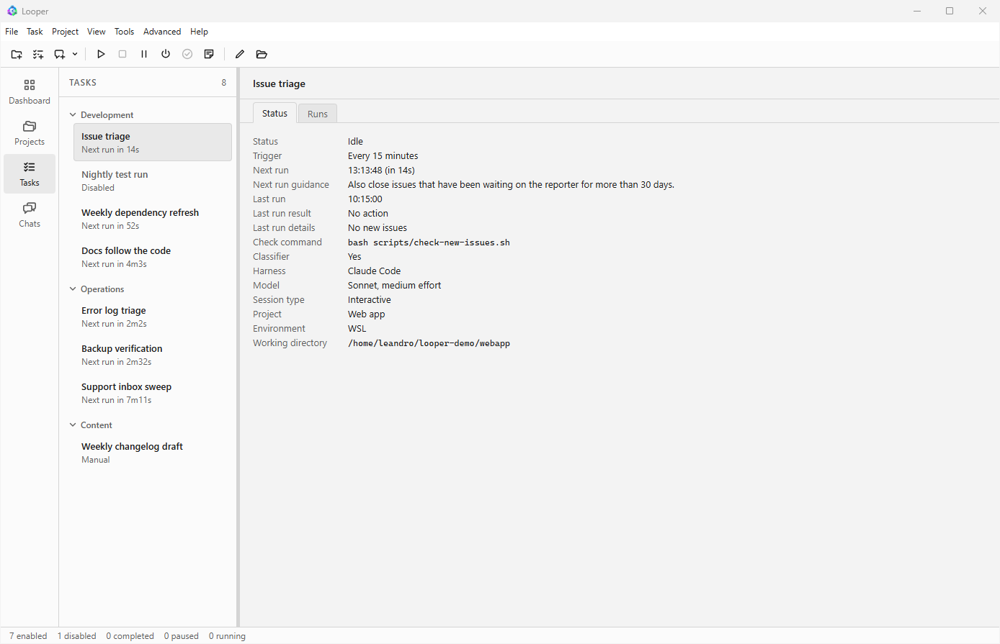
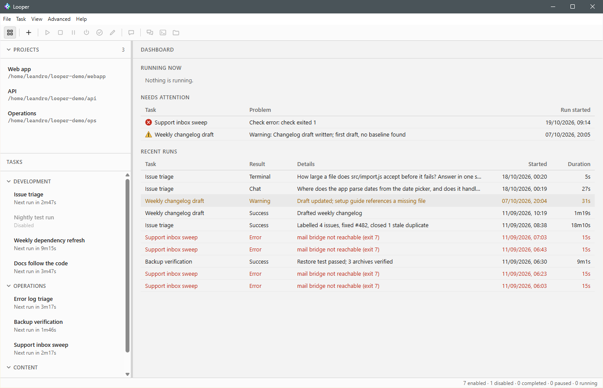
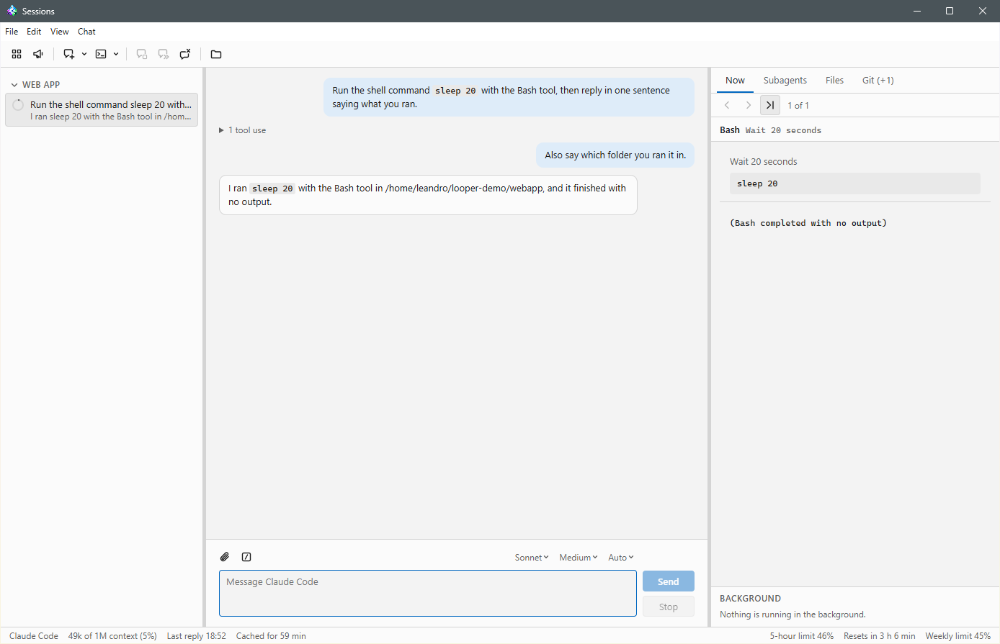
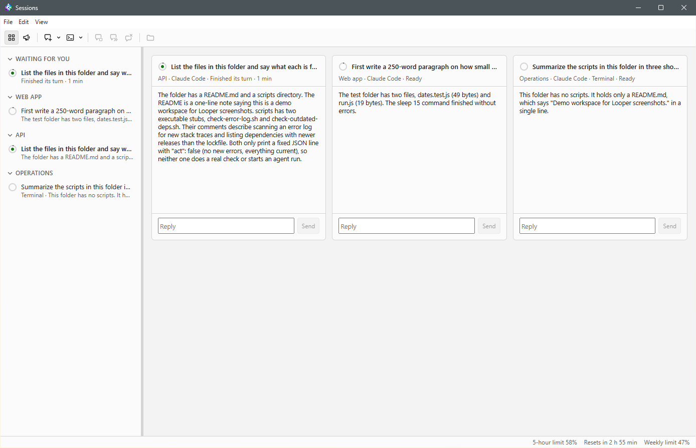
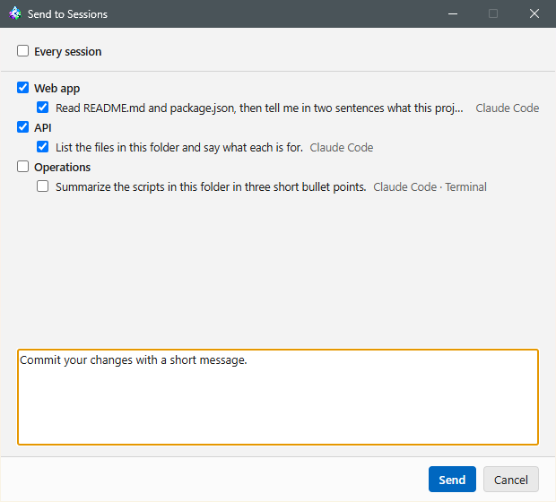
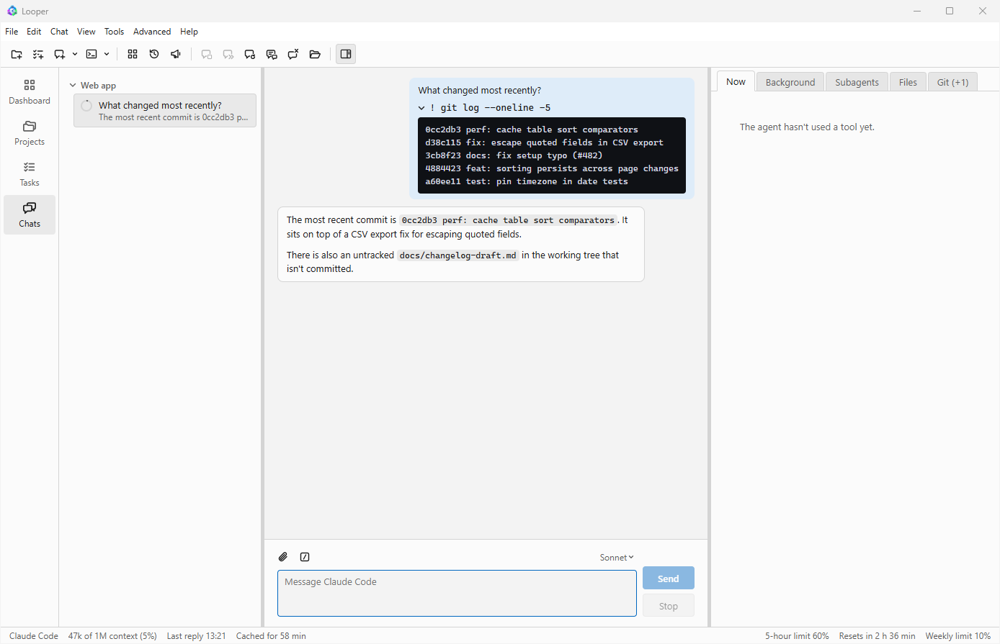
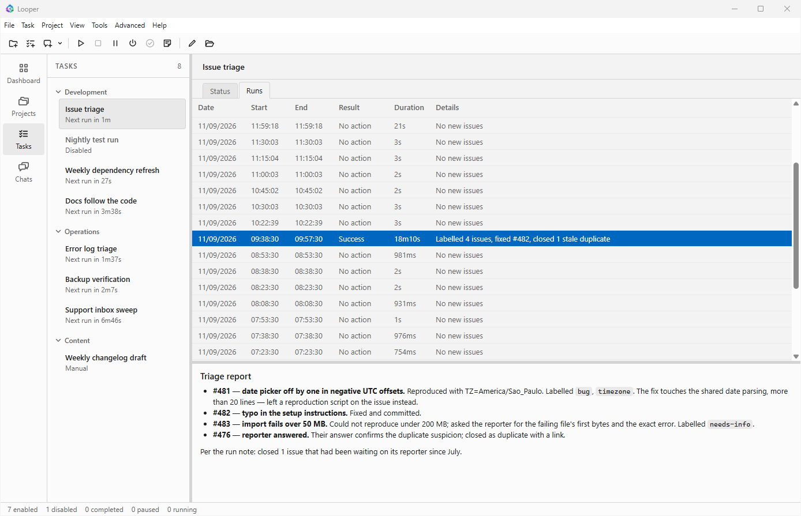
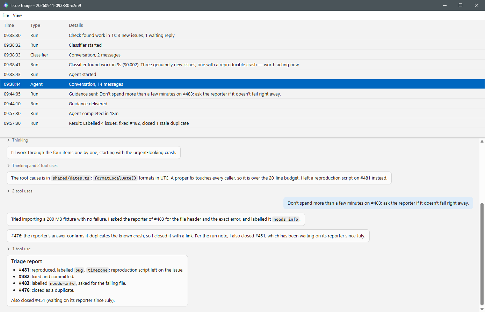
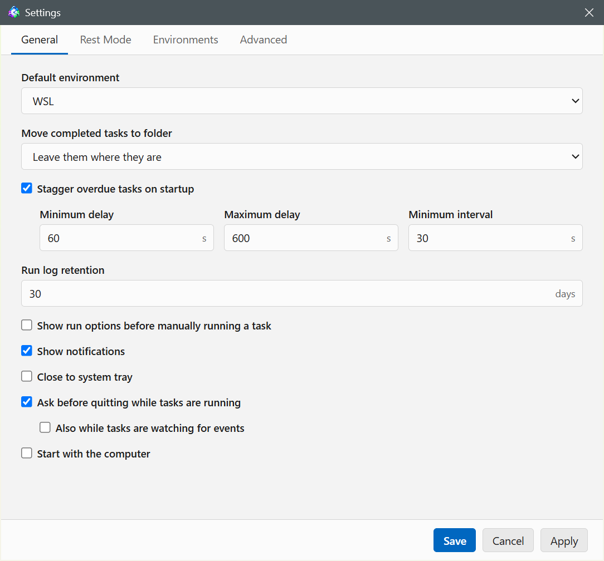

# Monitoring and controlling tasks

## The main window

The main window has tabs: **Dashboard**, **Projects**, **Tasks** and **Chats**,
then one for each tab an [addon](addons.md) adds. The window opens on the tab
it showed last, and on the Dashboard the first time.

- **Dashboard** shows the [dashboard](#the-dashboard) across the whole window.
- **Projects** lists your [projects](projects.md) on the left, under the
  header **Projects** with their count, and shows the selected project's view
  on the right ("No project selected." when none). Right-click the list for
  **Group By**, **New Project** and **New Folder** (see
  [Folders](projects.md#folders)).
- **Tasks** has the task list on the left, with the panes that addons add,
  and the selected task, or the selected item of an addon's pane, on the
  right. With nothing selected, the right side shows the tasks'
  [dashboard](#the-dashboard): Running now, Needs attention and Recent runs.
  Click the empty space below the task list to go back to it.
- **Chats** shows what the [Chats window](#the-chats-window) shows: the chat
  list, the conversation and the activity pane.
- An addon's tab shows one of its screens across the whole window (see
  [Addon tabs](addons.md#addon-tabs)).

Each tab remembers what was selected on it: leave the Tasks tab with a task
selected, and it's still selected when you come back. Picking something that
lives on another tab switches to that tab. A task you open from the
Dashboard, a notification, or an addon selecting one of its items shows the
Tasks tab. A
new chat or terminal (New Chat, New Terminal, Continue in Chat, Fork from
Here, Compact into New Chat, Continue Compacted) shows on the Chats tab. When
the Chats window is open and you start the chat from another window (the
Chats window itself, a History window, the tray menu), it opens in the Chats
window instead.

Once a tab has the focus, the arrow keys move between tabs, and Home and End
go to the first and the last. The main window can't be made narrower than 800
pixels. When the chat list, the conversation and the activity pane don't all fit
at the window's width, **View → Activity Pane** switches the center column to the
pane, which takes the conversation's place over the whole column, and back; the
list stays. Once the window is wide enough for all three, the pane sits beside the
conversation again.

### Where the tabs go

**View → Tabs** puts the tabs on the **Left** (a column down the window's
left side, the default), at the **Top** (below the toolbar), or at the
**Bottom** (above the status bar). At the top or at the bottom, **Show Icons**
turns the icon before each tab's name on or off. On the left, **Show Labels**
turns the name under each icon on or off; an icon alone shows its name when
you point at it. The Tabs menu is only in the main window.

### A view in a window of its own

**Window → Dashboard**, **Projects**, **Tasks**, **Chats** and each addon tab open that
view in a window of its own, titled Dashboard, Projects, Tasks, Chats or the addon
tab's title. The window has that view alone, with a status bar and no tabs,
and its toolbar and menus have only what the view is about: a Tasks window
has the New and Tasks toolbars, and the File, Task and View menus; a
Projects window has the New and Projects toolbars, and the File, Project and
View menus; a Dashboard window has File, Task and View, and no toolbar.
Settings, Templates, Tools, Advanced and Help stay in
the main window. Opening the window again brings it forward. In a Dashboard or Projects
window, opening a task shows it on the main window's Tasks tab. **Window →
Chats** opens the Chats window.

### A task or project in its own window

Double-clicking a task in the task list, or a project in the Projects tab's
list or a project's Tasks tab (or pressing Enter on it), opens it in a window
of its own, titled with its name. The window has the task's or the project's
view alone, without the list, with a status bar, and its toolbar and menus have
only that task's or project's commands, without New items or addon buttons.
Opening it again brings it forward, and the window closes when the task or project is deleted. Edit Task
is on the toolbar (Ctrl+E) and in the Task menu. Double-clicking a chat or a
task run in the Chats list opens it the way [Open in New
Window](#a-chat-in-its-own-window) does.

Phones keep their own tab bar, with Dashboard, Projects, Tasks and Chats and
no addon tabs (see [Remote Access](remote-access.md#on-a-phone-or-tablet)). A
browser on a computer shows the layout above, with the tabs.

### The Tasks tab

The sidebar lists your tasks by name, with a status line under each one:
what it's doing right now if active ("Needs attention" while a run is held
for you or its agent waits on an answer to its question), otherwise a next-run countdown, "Not scheduled", "Manual", its
paused reason, "Disabled", or "Completed" with the date it finished for good.
A watcher task reads "Watching" while its watcher command is up, "Watcher
restarting" while Looper waits to restart it, and "Idle" outside its active
hours. Disabled and completed tasks are
shown faded. Selecting a task opens its detail pane with two tabs: Status and
Runs. Double-clicking a task opens it in a window of its own (see
[above](#a-task-or-project-in-its-own-window)).

Installed [addons](addons.md) can add panes below the task list. Selecting
one of their items shows the addon's screen for it in the detail pane.

### The status bar

The status bar at the bottom of the window shows, on the Chats tab, what the
Chats window's status bar shows (see [The toolbar and status
bar](#the-toolbar-and-status-bar)). On the other tabs its left end counts
enabled, disabled, completed, paused, and running tasks, the [Remote
Control](#remote-control) conversations, and, once an addon is installed, the
running [addons](addons.md). Its right end shows what's on, on every tab:
while Rest Mode is on, what it's doing (see [Rest Mode](#rest-mode)); while a
[Prevent Sleep](#prevent-sleep) timer is on, until when; and while
[Remote Access](remote-access.md) is on, each of its sources with its address
(for example **Tailscale: https://looper.example.ts.net**) or what it's
waiting for.

### The menus and the View menu

The menu bar follows the tab. File, View, Tools, Advanced, Window and Help are
always there. The **Task** menu shows on the Dashboard and Tasks tabs, and the
**Project** menu on the Dashboard, Projects and Tasks tabs. The Project menu
acts on the selected project, or the selected task's: New Task in Project…,
New Chat (Ctrl+T), New Terminal (Ctrl+Shift+T), Edit Project…, Open Folder and Delete
Project…. It's greyed out while neither is selected. On the Chats tab the
menu bar has the Edit menu and, while a chat shows, the Chat menu, and the
File menu gets the Chats window's items (see [The Chats window](#the-chats-window)).
The File menu starts with **New Project…**; **New Task**, a submenu with
**Blank Task…** (Ctrl+N), **From Template…** (Ctrl+Shift+N) and **With
Agent…**; **New Chat**, a submenu; and **New Folder…**. In **File → New Chat**,
the **Chat** and **Terminal** submenus list your projects, then **Other
Folder…**, on every tab. On the Chats tab (and in the Chats window), **File →
New Chat** starts with **Chat in <project>** (Ctrl+T) and **Terminal in
<project>** (Ctrl+Shift+T) for the shown conversation's project, and **New
Folder…** is greyed out, since chats have no folders. There the task items
don't take Ctrl+N and Ctrl+Shift+N, so a terminal session keeps those keys.

The View menu, from the top:

- **Task History** (see [the Task History window](#the-task-history-window)),
  and **Tabs**, in the main window only (see above).
- The shown tab's options. On the Dashboard tab, **Task Runs** (see
  [below](#the-dashboard)). On the Projects tab, **Group Projects By** (see
  [Projects](projects.md#the-projects-tab)). On the Tasks tab, **Dashboard**,
  which shows the tasks' dashboard, a check box for
  each pane that shows or hides it: **Tasks Pane** (or **Goals Pane** and
  **Watchers Pane** with multiple panes), then each addon's panes. With every
  pane hidden the tab has no sidebar, and the detail pane takes the whole
  width. Then **Task List Options** and **Task Runs**. On
  the Chats tab, **Overview** (**Dashboard** in the Chats window), **Dashboard
  Filter**, **Dashboard Layout**, **Activity Pane**, **Show Thinking**,
  **Show Task Runs**, **Group Chats By** and **Waiting Chats First**.
- **Toolbars**, a submenu of check boxes with the main window's toolbars: New
  Toolbar, Projects Toolbar, Tasks Toolbar and Chats Toolbar, then each
  addon's "<addon> Toolbar" (see [The toolbar](#the-toolbar)); a view window has
  its own, and the Chats window has **Toolbar** and each addon's check box
  instead. Then **Status Bar**.

The Tools menu has **History** (see [the History window](#the-history-window)),
**Recycle Bin**, **Templates**, the addons' tools, **Agent Settings…** and
**Settings**. The Window menu lists the windows that are open, and in the main
window, **Dashboard**, **Projects**, **Tasks**, **Chats** and each addon tab,
which open that view in a window of its own (see above). On the Chats tab and in
the Chats window it also has **Previous Waiting Chat** and **Next Waiting Chat**
(Shift+F8 and Shift+F9), **Previous Chat** and **Next Chat** (F8 and F9), and
**Next Pane** and **Previous Pane** (F6 and Shift+F6); a chat's own window has
the pane items and **Always on Top**.

Right-clicking the empty space below a list (the task, project and chat lists,
the dashboard's lists and the History windows' list) opens that list's View
options, such as its grouping and filters; on a phone they're in the list's
More menu.

Ctrl+= and Ctrl+- zoom a window in and out, Ctrl+0 goes back to 100%, and
Ctrl+wheel zooms too. Each kind of window remembers its zoom.

## The dashboard

The **Dashboard** tab shows the dashboard across the whole window. It's what
the window opens on the first time. The Tasks tab shows the same lists, without
Remote Control, while no task is selected.

**Running now** lists every run in progress, oldest first: the task, its
step (Checking, Classifying, Running agent, Waiting for you, or Waiting for
your answer), what
triggered it (Schedule, Manual, or Event), when it started, and how long it
has been going.

**Needs attention** lists each task that needs you, errors first, with the
problem and when its run started. A task is listed when:

- a run is waiting for you (warning icon), until you send it guidance in the
  run window, which the row opens;
- a run's agent [asked you a question](how-a-run-works.md#questions-from-the-agent)
  (warning icon), until you answer it in the run window, which the row opens,
  or the agent's wait runs out;
- it was auto-paused after too many consecutive errors, or because its
  watcher kept crashing (error icon);
- its last run ended in an error, a time-out or an idle time-out (error
  icon), or a warning (warning icon), until a later run ends well.

Disabled and completed tasks aren't listed. **Clear** takes everything off the
list, and each finished run moves to Recent runs. Clearing only changes the
list: a run that waits for you keeps waiting, under Running now, and an
auto-paused task stays paused. A new problem shows on the list again. On a
phone, Clear is the last row of the list, and the runs under Waiting for You
stay.

**Recent runs** lists the 10 latest finished runs across every task and
project, newest first: the task or project, its result, its
details, when it started, and how long it took. A run shows here once it
ends, and a run that Needs attention lists isn't repeated here. It lists
task runs only: chats and terminal sessions show in their project's Chats tab
instead. It follows the same **View → Task Runs** choices as the Runs tab.

**Remote Control** shows while Remote Control is on and lists its open
sessions (with the chats and terminals that started with it): the session,
its status, its last message, and when it started.

While the Dashboard tab shows, the toolbar has only its New buttons. Clicking a
row picks it, and the Task menu and the row's right-click menu then act on
that task. Stop Task stops that row's run.
Double-clicking a row, or pressing Enter, opens the run's window for a row of
a running run, a held run or a question, and for a row about a failed run;
other rows show the task on the Tasks tab. A row in Recent runs opens its run's window, and its right-click
menu is the run's menu from the Runs tab.

Tasks and folders can be reordered by dragging them; the order is saved. The
Projects tab's list and its folders drag the same way (see
[Folders](projects.md#folders)).
Dropping a task on another task inserts it there (joining that task's
folder, if any); dropping it on the middle of a folder header moves it into
that folder; dropping it on the empty space below the list moves it to the
end of the top level. Tasks and folders mix freely at the top level: the
top edge of a folder header drops before the folder, and the bottom edge of
a folder's last row (a full-width line, instead of the indented in-folder
one) drops after the folder. Dragging a folder header moves the whole
folder.

The Status tab lists the task's current state as plain fields: Status,
Completed (date and reason, when the task is finished for good), Trigger,
Watcher command (watcher tasks only), Next run, Stops running on (when the
trigger has an end date), Next run guidance (when a one-off note is set), Last
run, Last run result, Last run details, Check command, Classifier (Yes/No),
Harness, Model, Session type, Environment, and Working directory. For a
watcher task, Next run reads "When the watcher fires" while it's watching;
outside its active hours, Status reads Idle and Next run shows when watching
starts again.

**View → Task List Options**, on the Tasks tab, holds a Standard or Compact
task list (Compact drops the status line), whether disabled, completed,
scheduled, manual, and watcher tasks are listed at all, and whether
folders open automatically (folders start open, and opening one opens its
whole subtree; unchecked, folders start closed). **View → Task Runs**, on the
Dashboard and Tasks tabs, picks what every task's Runs tab and the dashboards'
Recent runs list: **Show Skipped Runs** (the runs the scheduler skipped or
deferred, and the ones whose steps Run Options skipped) and **Show Runs with
No Action** (the runs whose check or classifier found nothing to do), both on
at first.

The Advanced menu has Remote Access (see [Remote Access](remote-access.md)),
Remote Control (see [below](#remote-control)), Addons… (see
[addons](addons.md)), Start Rest Mode (Windows only, see
[Rest Mode](#rest-mode)), Prevent Sleep (see [below](#prevent-sleep)), Update Models… (see
[Models](environments.md#models)), Engine Log (described below), Open Data
Directory, which opens the [data directory](cli-and-automation.md#the-data-directory)
in your file manager, and Reload UI. **Help → Instructions** (F1) opens this
guide in its own window, and Help → About Looper shows the version.

## The toolbar

The main window has a toolbar for each kind of item, and shows the ones that
belong to the tab: the **New** toolbar on every tab, then the shown tab's own
(**Projects**, **Tasks** or **Chats**), then the buttons that addons add (see
[Addons](addons.md#menus-and-toolbars)), a toolbar for each addon, and the
buttons of the addon screen that shows, if one does. **View → Toolbars** (or a
right-click on the toolbar area) has a check box for each toolbar, to show
or hide it. Looper remembers the choice.

Each toolbar starts with a grip, a column of dots. Drag the grip to move the
toolbar along its row, to another row, or above the first row or below the last
to start a new one; a line shows where it will land. Drag a toolbar's right edge
to give it a width, and double-click the edge to give it its buttons' width
again. A toolbar narrower than its buttons ends in a double chevron, whose menu
lists the buttons that don't fit. Looper remembers the layout, which every
window with these toolbars shares.

The New toolbar's buttons, left to right, with their tooltips:

| Button | Tooltip | Shortcut |
|---|---|---|
| Folder with a plus | New Project (the same as File → New Project…) | — |
| Checklist with a plus | New Task, or New Task in &lt;project&gt; while a project or a task is selected; its arrow lists Blank Task, From Template and With Agent | — |
| Bubble with a plus | New Chat in &lt;project&gt;; its arrow lists the projects | Ctrl+T |
| Terminal | On the Chats tab only: New Terminal in &lt;project&gt;; its arrow lists the projects | Ctrl+Shift+T |

On the **Tasks** toolbar, the first buttons are **Dashboard** (stays pressed
while the tasks' dashboard shows, which is what the tab shows with no task
selected), **Task History** and **Recycle Bin**. The buttons after them act on
the selected task:

| Button | Tooltip | Shortcut |
|---|---|---|
| Run | Run Now | F5 |
| Stop | Stop Task | Shift+F5 |
| Pause/Resume | Pause / Resume | Ctrl+P |
| Power | Enable / Disable | — |
| Check | Complete / Reopen | — |
| Edit | Edit Task | Ctrl+E |
| Note with a folded corner | Add Guidance for Next Run / Edit Guidance for Next Run | — |
| Open folder | Open Working Directory | — |

On the **Projects** toolbar, the buttons are Edit Project and Open Folder, for the
selected [project](projects.md). The **Chats** toolbar has the Chats window's
buttons, from Overview to Activity Pane (see [The toolbar and status
bar](#the-toolbar-and-status-bar)). The Dashboard tab has only the New
toolbar. While a dashboard shows, the Task menu acts on the row you picked.

New Chat and New Terminal start the session in the selected project, the
selected task's project, or the shown chat's. With none of them, or from the
arrow beside the button, they list your projects to pick one, then **Other
Folder…** (see [the Chats window](#the-chats-window)). The lists follow the
Projects tab's folders and order.

Running Now on a disabled or completed task asks '"<task name>" is disabled.
Run it anyway?' first — the run happens, and the task goes straight back to
being disabled or completed afterwards. With **Settings → General → Show run
options before manually running a task** on, Run Now opens the Run Options
window instead of starting the run right away (see
[run options](how-a-run-works.md#run-options-for-a-manual-run)). Stop Task stops the
selected task's runs (on the dashboard, the picked row's run). Pause/Resume, Enable/Disable and
Complete/Reopen swap their tooltip and icon
depending on the task's current state; Pause and Enable/Disable are greyed
out for a completed task, which is parked until you reopen it. Complete is
greyed out unless the task's **Allow this task to be marked completed**
option is on (Reopen always works), and asks for confirmation, since the task
moves to the [Recycle Bin](#the-recycle-bin) once its retention runs out.
**Project → New Terminal** (or "Open Project in Terminal" in a task's
right-click menu) opens a terminal session in the task's
[project](projects.md), with the project's environment, working directory,
harness, model and permission mode ready to go, and no prompt. See [terminal
sessions](#terminal-sessions) for where it opens.

## The Chats window

Chats and Looper terminal sessions show on the **Chats** tab of the main
window, and in the **Chats** window, which has the same view in a window of
its own. It lists every open session on the left, grouped as **View → Group Chats
By** says (see [the chat list](#the-chat-list)), shows the selected one in the middle, and
shows what its agent is doing on the right. **Window → Chats** and **Show
Chats** in the tray menu open the window. Starting a chat or a terminal
session anywhere in Looper shows it on the Chats tab, or in the Chats window
when it's open and you start it from another window (see [The main
window](#the-main-window)). On the Chats tab, the main toolbar and menus have
what the window's have: its toolbar buttons follow the New buttons, and its
File, Edit and Chat menus are in the menu bar.

Closing the window leaves every session running, and opening it again shows
them where they are. **File → Close Conversation** (Ctrl+W or Ctrl+F4, the
toolbar, or right-click a session) ends one session for good, and **File →
Close All Conversations** ends them all. Right-clicking a project's group in
the list has **Close All Conversations** too, which ends only that group's
chats and terminal sessions. Close All Conversations always asks first. Close
Conversation closes at once, unless the agent is working or waits for a
permission answer, when closing would stop it and Looper asks. With
**Settings → Chats → Ask before closing a conversation** it asks every time,
except for a chat with no messages yet, or, with **Close conversations without
asking once their cache has expired** under it, once the prompt cache of the
agent's last reply has expired (the status bar says "Cache expired").

Right-clicking a project's group in the list also has **New Chat**, **Edit
Project…** and **Open Recent Chat**,
a list of the project's 15 most recent conversations, from its tasks' runs and
from Claude Code or Codex in its folder, as in the [History window](#the-history-window).
Picking one goes on with it in a chat, or shows it when it's already open.

Right-clicking a chat has the Chat menu's commands for it, with **Open in
Terminal**, **Open in New Window**, **Edit Project…**, **Mark as Unread**,
**Open Working Directory** and **Close Conversation**. Right-clicking a task
run in the list has **Send Guidance…**, **Stop Run…**, and **Open in Terminal**,
which goes on with the run's conversation in a terminal session as a run's
Continue in Terminal does, after asking while the run is going, since its agent
stops.

Quitting Looper doesn't close them: it stops every session's agent (asking
first while a chat's agent works or a terminal session runs), and the next
time Looper starts the Chats window lists the same chats and terminal
sessions, in the same groups and order, with their conversations, settings
and unsent messages. Nothing runs until you go on with one: a chat's agent
starts again with your next message, and a terminal session shows its output
from before and "stopped when Looper quit · press any key to go on"; the key
you press starts the harness again on the conversation (it isn't typed into
it), at the window's size. A turn that quitting cut short shows as stopped,
as Stop leaves it, and a message waiting in a chat's queue comes back in its
message box. A terminal session that quitting stopped isn't listed in Send to
Chats until a key starts it again. A custom harness's terminal sessions,
which have no conversation to go on with, close when Looper quits.

**File → New Chat → Chat in
&lt;project&gt;** (Ctrl+T) opens a chat in the shown session's project, and
**New Chat** in a project group's right-click menu in the list opens one in
that project. In a terminal session, Ctrl+T and Ctrl+W go to the terminal, and Ctrl+F4 still
closes it.

**File → New Chat → Chat** and **File → New Chat → Terminal** (and the arrows
beside the toolbar's New Chat and New Terminal buttons) list your projects, then **Other
Folder…**, which asks for a folder and starts the session there without a
project. It runs in your default environment, or on Windows a folder in WSL
(`\\wsl.localhost\<distro>\…`) runs in that distro's WSL environment, with
the harness, model and permission mode a new project there would get. The
list groups such sessions under their folder, and a folder that already has a
project opens in that project. **File → New Project…** (also in those button
menus) opens the New Project window.

**Chat → Copy Session ID** (or right-click a session) copies the harness's own
id for the conversation: Claude Code's session id, or Codex's thread id, the
one `claude --resume` or `codex resume` takes. It's greyed out until the
harness has started the conversation.

**Chat → Rename…** (or right-click a session, or select it in the list and
press F2) names a chat or terminal session. The name shows in the list, the
dashboard, the chat's own window and History. A running Claude Code chat gets
the name too, so its transcript has it. Clear the name and save to go back to
the automatic one. A chat starts with its first message as its name. After its
first turn, Looper asks Claude Code to name a Claude Code chat, and the chat
takes that name (its transcript keeps it too); if Claude Code can't, the first
message's stays. A chat that goes on with a conversation that already has a
name (Continue in Chat on a run or in History) keeps that name. A Codex chat
keeps its first message's name. A terminal session takes the name Claude Code
or Codex gives its conversation once there is one. A name you give always wins.

When a session's turn fails because the account is out of its usage limit,
the dot in its icon turns red. Once the limit has reset, the dot turns green
and larger until you look at the session. With **Chat → Continue When Limit
Resets** (also in a chat's right-click menu) on, Looper sends the agent
"Continue." a minute after the reset time, under the note "The usage limit
has reset: continuing." When the harness doesn't say when the limit resets,
Looper tries every hour. A message you send first, turning the option off, or
closing the chat cancels it. **Settings → Chats → Continue chats once the usage
limit resets** turns the option on for new chats.

A line under the limit's message says what will happen, with a button to change
it: "Looper will continue this chat at 17:01" with **Don't Continue**, or
"Looper won't continue this chat when the limit resets" with **Continue When
Limit Resets**. With **Settings → Chats → Don't continue once the cache has
expired and the context is larger than** on, Looper doesn't send "Continue." to
a chat whose cache has expired by then and whose context is over that size, and
at 0k it only continues a chat whose cache still lasts. The line says so, and
**Continue Anyway** sends it at the reset time, or at once if that has passed.

**Stop** ends the agent's turn at once, and the conversation goes on with your
next message. Background subagents and workflows the agent started keep
running, each with its own Stop in the activity pane (see [the activity
pane](#the-activity-pane)). It's on the toolbar, in a session's right-click menu, under a
chat's Send button, and in the Chat menu (Esc in a chat). In a chat, Looper asks Claude Code to stop, which
it does right away, and ends the process if it hasn't stopped within 5
seconds. Codex's turn ends with its process. In a terminal session, Stop
presses Esc for you.

**Restart Agent** (the toolbar, **Chat → Restart Agent**, or right-click a
session) ends the agent's Claude Code or Codex process and starts a new one on
the same conversation, with the chat's settings. Use it when the agent is
stuck, or when its session ended. It asks first while the agent works, and
then ends the turn as Stop does. In a chat, the conversation shows
"Restarted Claude Code." (or Codex), and Claude Code's new process starts at
once; Codex starts one with each turn anyway. In a terminal session the
terminal shows "restarted" and the harness starts again after the output it
had, at the window's size, on its conversation once it has taken a message
(Claude Code) or finished a turn (Codex). A custom harness's
terminal session can't restart.

With **Settings → Chats → Stop the harness once a conversation's cache
expires**, Looper ends the harness's process of each chat and terminal
session that's idle once the prompt cache of its last reply expires, so it
doesn't keep running for nothing. A session that waits for a permission
answer, or runs background work, keeps its process, and so does a terminal
session you've typed into since the agent's last reply. Nothing is lost: a chat
starts its agent again with your next message, and a terminal session shows
"stopped when the prompt cache expired · press any key to go on", where the
key you press starts the harness again on the conversation, as after quitting.

Claude Code's transcript says how long its cache lasts. Codex doesn't say, so
for a Codex session Looper counts 30 minutes from its last reply, the least
OpenAI's cache lasts for GPT-5.6 and later. The cache can last longer, so a
Codex session that shows "Cache expired" may still have it.

### A chat in its own window

**File → Open in New Window** (or right-click a chat, or double-click it in the
list) opens the chat in a
window of its own, titled with the chat's name. It shows the conversation like
the Chats window's middle pane, without the list; **View → Activity Pane**
shows the [activity pane](#the-activity-pane) on its right (it starts hidden),
and Looper remembers the pane's width apart from the Chats window's. **Window →
Always on Top** keeps the window above your other windows until you turn it
off or close the window.
The chat stays in the Chats window too, and you can write in either one: both
show the same conversation as it happens. Its File, Edit, View, Chat and Window menus have
the commands about the chat. Opening it again brings its window to the front,
and closing the window leaves the chat running; Close Conversation ends the
chat and closes its window. Terminal sessions stay in the Chats window.

### The chat list

Each session has an icon, its title (its first message), and a second line
with the agent's last text message since yours (never a tool it uses), or its
state while it hasn't written one yet. The icon's ring fills with
how much of the model's context the conversation uses (yellow from half, red
from 80%), and its dot shows the session's state: blue and pulsing while the
agent works, yellow while it waits for you, green when it finished a turn you
haven't looked at yet, and grey once the session ended.

**Waiting for you**, at the top, repeats the sessions that need you, the one
that has waited longest first, with the reason and how long it has waited:

- the agent asks for permission to use a tool;
- it finished a turn you haven't looked at yet;
- it sent a notification;
- the session ended without you seeing it;
- you marked it unread (see below).

A session's title shows in bold, in the list and on the dashboard, while it
waits for you for any of these reasons. Looking at the session takes it off the
list, except a permission request, which stays until you answer it.
**Mark as Unread** (the Chat menu, and the right-click menu of a chat or terminal
session in the list or on its dashboard card) makes a session that's ready and
not waiting wait as a finished turn again, with "Marked as unread", until you
open it. No device gets a notification for it. It's off while the agent works
(its next turn is news anyway) and while a permission request waits, which
stays bold until you answer it. Once a session is unread, the same item reads
**Mark as Read** and marks it seen. On a phone or tablet it's in a chat's More
menu and in the long-press menu of a chat or terminal session in the list, and
swiping a row to the right shows **Unread** (or **Read**) behind it. **View → Waiting Chats First** (on at first)
shows Waiting for you, and puts the waiting sessions' cards first on the
[dashboard](#the-dashboard); turned off, the list shows only the projects'
groups. Looper remembers the setting.

**View → Group Chats By** chooses the groups. **Project**, the default, makes
one for each project in the Projects tab's order, then one for each other folder
a chat was opened in. **Project Folder** makes one for each of the Projects
tab's folders that has chats, named with the folders it's in ("Clients /
Acme") and in that tab's order, and then **No Folder** for the chats of projects
in no folder and for chats opened in another folder. **None** lists every chat
in one list without group names, in the order they started, and you can drag a
chat to another place there (on a phone, **Reorder** in the list's More menu
moves them in a sheet). Looper remembers the grouping, but the order you drag
chats into only until Looper closes. Right-click the empty space below the list for
**Show Task Runs**, **Group Chats By** and **Waiting Chats First**; a phone has
them in the list's More menu.

Clicking a group's name closes or opens it, and Looper remembers which groups
are closed. Up and Down move through the sessions shown, and a click on the
empty space below the list shows the dashboard. Shift+F8 and Shift+F9 (or
Ctrl+Shift+PageUp and Ctrl+Shift+PageDown) go to the previous and next session
that's waiting for you, and F8 and F9 (or Ctrl+PageUp and
Ctrl+PageDown) to the previous and next session. Ctrl+1 to Ctrl+8 go to the
session at that place in the list, counting the projects' groups and not
Waiting for you, and Ctrl+9 to the last one. F6 and Shift+F6 move between
the chat list, the conversation and the activity pane. The View menu has
the same commands.

**View → Show Task Runs** also lists the agents of task runs in flight, under
their task's project (or the task's name), with "Task run" on their second
line. One shows the agent's conversation as it happens, read from its
transcript, with the activity pane beside it; it waits for you in **Waiting
for you** while the run holds for you or waits for your answer to its
question. A task run leaves the list when its agent step ends. While its agent
runs on Claude Code or Codex, a box under its conversation sends it
[guidance](how-a-run-works.md#guidance-for-a-run-in-progress), as the run
window's box does (Send, or Enter; Shift+Enter breaks the line, and on a phone
Enter does too): the agent gets it mid-run. It looks like a chat's message
box, with Send above Stop. While the
agent waits for your answer to its question, the question shows above the box,
and what you send is the answer. The run's dashboard card has the same box,
and its right-click menu has **Send Guidance…** and **Stop Run…**. Stop Run…
stops the whole run, the same as Stop on the Tasks tab, not only its
conversation, so Looper asks first; **Stop** in the toolbar and beside the box
stops at once.
A task run has no Close Conversation, and Send to Chats doesn't list it. Looper
remembers the setting.

### The dashboard

The dashboard shows every session as a card, in the list's order, so a card
stays in place while you work in it. Drag a card by its title to another place
(a bar shows which side of a card it goes to), and Looper remembers the order;
a new session's card comes after the ones you placed. With **View → Waiting
Chats First** on, the sessions waiting for you come first, the one that has
waited longest first, and go back to their place once they stop waiting. A card's title bar shows the session's
project and harness, its state, and how many commands or subagents it runs in
the background; a session waiting for your answer has a yellow border.

A chat's card is the whole chat, as it shows when you open it but without the
activity pane: its messages, its permission requests with Allow and Deny, the
status line, and the message box with Attach Files, the skill list, the
harness, model, effort and permission mode (one button in a narrow card), Send
and Stop. So you can follow and answer
several chats at once without opening them. Working in a card counts as
looking at the chat, and Esc stops the agent of the card you're typing in.

A task run's card (with **View → Show Task Runs**) is its conversation, as it
shows when you open it but without the activity pane: its messages and tool
calls, kept current while the run goes on, the question its agent asks, and
the guidance box, which sends the agent guidance or the answer to its
question. A chat's or task run's card scrolled far out of view shows the
agent's latest messages until it comes back.

A terminal session's card shows the agent's messages since your last one,
with a message box like a chat's below them: Send (or Enter; Shift+Enter
breaks the line) types your reply into the terminal, and Stop sends the agent
Esc while it works or asks for a permission.

The button at the right of a card's title bar, **Double Size**, makes the card
twice as wide and twice as tall, and **Normal Size** puts it back. The card's
right-click menu has the same command. Looper remembers each card's size.

The cards fill as many columns at least 340 pixels wide as fit, and two rows
fill the view (each row at least 320 pixels tall). Pointing at the gap
between two cards shows a bar there: drag a gap between two columns to make
the column on its left wider or narrower, and a gap under a row to make that
row taller or shorter (down to 200 pixels). The columns before the one you
size keep their widths, and the rest of the width goes to as many columns as
fit: a column that would be narrower than 340 pixels goes, and when nothing
fits after your columns, the last one reaches the edge. A narrower window
drops the columns it has no room for and brings them back when it's wider
again. Double-click a gap to give its column or row the automatic size
again. Looper remembers the widths and heights.

**View → Dashboard Layout** (the toolbar's **Layout** button, which shows
while the dashboard does) chooses **Grid**, described above, or **Focus**.
Focus shows one conversation large, with its message box, and the other cards
stacked in a column on its right that scrolls and has no message boxes. The
cards meet at a thin border, with no gaps. Click a card in the column to swap
it into the large spot, and drag the line between the two to size the column
(360 pixels at first, at least 240). Looper remembers the layout, the large
conversation and the column's width. On a tablet Focus is the same, and on a
phone the large conversation is on top with the other chats as a row of small
cards above it that scrolls sideways.

**View → Dashboard Filter** (the toolbar's **Filter** button) has **Only Chats
Shown in the List**, which leaves out the chats in groups you've closed, and
**Show Hidden Chats**. **Hide from Dashboard** in a card's right-click menu takes
that chat off the dashboard, and **Show on Dashboard** puts it back while Show
Hidden Chats shows it. Looper remembers each choice.

Clicking a chat's or task run's title bar (or anywhere on a terminal session's
card) opens the session, and right-clicking it has the session's menu. The toolbar's Dashboard button
(named Overview on the Chats tab), **View → Dashboard** in the Chats window,
or a click below the list shows the dashboard.

### Subagents and workflows

Once the agent starts a subagent, tabs appear above the conversation:
**Conversation** for the session's own, then one per subagent, named by what
it does. A subagent's tab has the same icon as a session in the list: the
ring around it fills as the subagent's context fills (once Looper knows how
large its model's context window is, which Claude Code says at the end of a
chat's turn or a headless task run; Looper remembers each model's window, so
terminal sessions, task runs and the History window use it too), and the
dot in the middle pulses while it runs, turns green when it's done and red if
it failed. Clicking its tab shows its conversation as it happens, and Now follows its
tool calls.

In a chat on Claude Code that hasn't ended, the tab of a subagent that is
still running has a message box under its conversation, which reads "Message"
and the subagent's name. What you send there goes to the subagent itself, and
the chat's agent doesn't see it. It waits at the end of the subagent's
conversation, under "Waiting for the subagent", until a tool call of the
subagent's ends: Looper hands the subagent your message with that call's
result, and it shows in the subagent's conversation as guidance from then on.
Cancel takes the message back while it waits. A subagent that finishes before
it reads the message (its last call hands its report back, and the message
can't come with that one) never gets it: the message stays at the end of its
conversation, under "The subagent finished before reading this.", until you
leave its tab. A finished subagent's tab has no message box.

A subagent's last call, which hands its final report back to the main agent,
shows in its tab as a message from the agent, under the line "Handed back to
the main agent", so the end of its session is easy to see.

A workflow the agent runs (Claude Code's Workflow tool, a script that starts
many subagents in phases) gets one tab after them, named by the workflow, with
the same dot for the whole run. Its tab has tabs of its own: **Overview**, then
one per agent the workflow started.

- **Overview** shows whether the run is still running and how many of its
  agents are done, how long it has run, and its phases in order. Each phase
  lists its agents with what each one does, whether it's running, done, failed
  or stopped, the model it runs on and how long it has taken. A running agent
  shows its latest tool call and its context, and a finished one the tokens and
  tool calls it used and the first line of its result, or its error. A phase
  no agent has started yet reads "Not started". Once the run ends, the
  workflow's log lines and its result follow the phases: Claude Code writes
  them only then. Clicking an agent shows its tab, and right-clicking it has
  **Open Subagent Conversation**.
- An agent's tab shows its conversation as it happens, and Now follows its
  tool calls. On the Overview, Now shows the session's own.

### The activity pane

The pane on the right has four tabs, and a fifth for a project in a git
repository. **View → Activity Pane** (or the toolbar's Activity Pane button)
shows or hides it. In a window too narrow for the list, the conversation and
the pane side by side, it takes the conversation's place instead (see [The main
window](#the-main-window)).

- **Now** shows the agent's latest tool call the way it looks on its screen. A
  command shows in a terminal, the command line and then its output, under its
  description as the title. A file it read shows in an editor with its line
  numbers and its code in VS Code's colors, Light+ or Dark+ with the theme, and a
  change it made shows the way GitHub shows one, light or dark with the theme:
  both files' line numbers, the
  added lines in green and the removed ones in red, the changed words darker,
  and a blue `@@` line above each part. Code read from the middle of a file is colored
  right even when it starts inside a comment or a string. A Markdown file it
  read or wrote shows formatted, as a page of a document; **Markdown Source**
  (angle brackets) shows its text instead, and a change to one shows as a
  change. A message the agent sends another agent (SendMessage), a
  subagent's final report, and the task the agent gives a subagent show as a
  message in a mail app: the subject, the sender and "to" the recipient, with a
  chevron that shows the call's other parameters, then the message formatted. An image it
  read shows as the image. A skill it loaded shows the skill's instructions as
  formatted text. Other tools show their parameters in a table, names on the
  left and values on the right, and then their result. An addon can change how
  its own tools show here (see [Addons](addons.md#how-tool-calls-show)). It
  follows each new call. The tab's **Previous Tool Call** and **Next Tool
  Call** buttons go back through the earlier ones, and **Follow the Latest
  Tool Call** goes back to following. **Tool Call List** (a bulleted list)
  shows every tool call instead, one per row with the tool and its file or
  command, and "Running" or "Failed"; the shown one is selected, Up and Down
  move, and a click or Enter shows that call. While Now follows the latest,
  the list keeps the newest in view.
- **Background** lists the commands and workflows the agent runs in the
  background (its subagents are in Subagents) at the top, under **Running** and
  **Finished**, with how long each has been running and how the ended ones
  ended. Its title counts the ones running. The selected one's output shows
  below the list, in a console, with a draggable divider between them (on a phone,
  the **Tasks** and **Output** tabs). Clicking a command shows the end of its output, and
  clicking a workflow shows its tab above the conversation. Right-clicking a
  running item has **Stop**, for a chat or task run on Claude Code (a terminal
  session's work stops in its terminal), and a command has Open File (its
  output file), Copy Path and **Copy Command**.
- **Subagents** lists the subagents the agent started, the newest first (a
  workflow's agents are in the workflow's tab): what each one does, whether
  it's running, its agent type, the model and effort it runs on, and how many
  tokens its context holds. The model, effort and context come from its
  latest reply, so they read "Not known yet" until it has one. The list is at
  the top, and the selected subagent's conversation shows below it. The tab's
  title counts the running ones. Right-click a subagent for **Open Subagent
  Conversation** in its own window, and **Stop** for a running one the agent
  started in the background.
- **Files** lists the files the agent sent you (under Received, each once, as
  in the conversation: images as thumbnails, which open like there), the
  files it changed and read, and the files you attached. Images show as
  thumbnails. Double-clicking a file, or pressing Enter on it, opens it in
  [Preview](#the-preview-window), or in its default program when Preview
  doesn't show its kind. Right-clicking it has **Open File**, **Show on
  Now** (the agent's last tool call on it), **Save As…** for a received file
  (copies it to a place you pick) and **Copy Path**.
- **Git** shows the session's project repository: its uncommitted changes and
  its history, with the lists above the changes; the sections have draggable
  dividers. It works like the project's
  [Git tab](projects.md#the-git-tab) in the main window.

### The toolbar and status bar

The toolbar's buttons, left to right, with their tooltips. On the Chats tab of
the main window the first two are on the New toolbar, and the rest on the Chats
toolbar:

| Button | Tooltip | Shortcut |
|---|---|---|
| Bubble with a plus | New Chat in &lt;project&gt;, the shown session's project; its arrow lists the projects and Other Folder… | Ctrl+T |
| Terminal | New Terminal in &lt;project&gt;; its arrow lists the projects and Other Folder… | Ctrl+Shift+T |
| Grid | Dashboard (stays pressed while the dashboard shows); Overview on the Chats tab | — |
| Funnel | Filter: Only Chats Shown in the List and Show Hidden Chats (only while the dashboard shows) | — |
| Layout | Layout: Grid or Focus (only while the dashboard shows) | — |
| Bullhorn | Send to Chats | — |
| Clock with an arrow around it | History: opens the [History window](#the-history-window); its arrow lists the 15 most recent conversations, each of which goes on in a chat (or comes forward, when a chat has it open), and More… | — |
| Bubble with a square | Stop (greyed out while the agent isn't working) | Esc in a chat |
| Bubble with fast-forward | Send Now: stops the turn, and the agent goes on with the chat's queued messages | Ctrl+Enter |
| Bubble with a circular arrow | Restart Agent: a new Claude Code or Codex process on the same conversation (greyed out for a task run and a custom harness's terminal) | — |
| Bubble with text and a small bubble | Compact into New Chat (greyed out while the agent works, and until it has replied) | — |
| Bubble with an X | Close Conversation | Ctrl+W, Ctrl+F4 |
| Open folder | Open Working Directory | — |
| Window with a right column | Activity Pane (stays pressed while the pane shows) | — |

The status bar shows the session's harness, then how much of the context the conversation uses, when
the agent last replied, and whether that reply's prompt cache
still lasts ("Cached for 4 min" or "Cache expired"). A message sent while the
cache lasts costs less and starts faster. On the right are the usage limits of
the Claude account the session's harness runs on, as Claude Code last reported
them in a chat on that harness: how much of the 5-hour limit is used, when it
resets, and how much of the weekly limit is used. Harnesses can run on
different accounts, so each one shows its own limits, and a harness shows none
until a chat on it has reported them. The dashboard shows no limits. **View →
Toolbar** (in the main window, **View → Toolbars**) and **View → Status Bar** show or hide them.

### Send to Chats

**File → Send to Chats…** sends one message to several chats at once.
Its window lists the open chats and terminal sessions by project (not a
terminal session that quitting Looper stopped, until a key in it starts it
again), with check
boxes to pick every chat, every chat of a harness, or a project's chats. To
send an announcement to one project's chats, right-click its group in the
Chats list and choose **Send to Chats…**, which opens the window with that
group's chats checked. A chat that's working gets the message in its queue,
and a terminal session gets it typed in and sent.

## The History window

The **History** window lists the conversations on this computer, to read one
or go on with it. **Tools → History** in the main window or the Chats window,
or the Chats toolbar's History button, opens it. It isn't on phones.

The list on the left has two kinds of conversation, newest first:

- Looper's own chats, terminal sessions and Remote Control conversations, as
  long as the run recorded a conversation. Task runs are in [Task
  History](#the-task-history-window).
- Every conversation in Claude Code or Codex, whatever folder it ran in,
  started outside Looper or by it. Looper reads them from the folders each
  environment's harnesses keep them in: Claude Code's config folder
  (`~/.claude`, or `CLAUDE_CONFIG_DIR` when the harness or your shell sets it)
  and Codex's home (`~/.codex`, or `CODEX_HOME`). A transcript that two config
  folders share through a link shows once.

There can be thousands of conversations of several MB each, so the list shows
the newest 100, and **Show More** at its end reads the next 100. Each row has
the conversation's title, then its project (or its folder's name, when no
project has the folder), when it was last active, and where it came from:
Chat, Terminal, Remote Control, Task run and the task's name, Claude Code or
Codex. Hovering over that line shows the whole folder. The title is the one
Claude Code gave the conversation (or the name you gave it with `/rename`),
else its first message; a task run's is the run's summary. A conversation
Looper started shows as Looper's even after run retention deleted its run
folder, and a conversation from outside that you went on with in Looper shows
once, as the chat. Looper keeps what it read of each conversation, so the list
shows at once the next time and then updates; **View → Refresh** (F5) reads
the folders again. The conversations it hasn't read before show as it reads
them, a few at a time, with a greyed **Loading…** at the end of the list until
the rest are in, and the window, like the rest of Looper, stays usable
meanwhile.

**View → Group by Date** groups the list by Today, Yesterday, This Week, This
Month, and then by each earlier month, and **View → Group by Folder** by folder: the projects first,
in the Projects tab's order, then the other folders. Looper remembers these settings.
**View → Folder** shows All Folders, one project's conversations, or the
ones Outside Projects.

**Edit → Find…** (Ctrl+F) shows the find bar above the list. Typing keeps the
listed conversations whose title has the text. **Search Messages** (or Enter)
reads the listed conversations' whole text instead, your and the agent's
messages without tool calls, and keeps the ones that have it, until you change
the text. Show More first to search older conversations too. Esc clears the
text, and Esc again or **Close** hides the bar.

The middle shows the conversation as a chat shows it, without a message box,
with a tab for each subagent it started above it. **View → Activity Pane**, or
the toolbar's button, shows the [activity pane](#the-activity-pane) on the
right, with only its Now and Files tabs; it's hidden each time the window
opens.

The toolbar's buttons, left to right:

| Button | Tooltip |
|---|---|
| Bubble | Continue in Chat |
| Bubble with text and a small bubble | Continue Compacted |
| Terminal | Continue in Terminal |
| Two sheets | Copy Session ID |
| Open folder | Open Working Directory |
| Window with a right column | Activity Pane (stays pressed while the pane shows) |

The File menu and a conversation's right-click menu have the same commands.
Enter or a double-click is Continue in Chat.

- **Continue in Chat** goes on with the conversation in a chat. A run of
  Looper's goes on the way its run's Continue in Chat does. A conversation
  from outside opens in a chat in its project, with the project's model,
  effort and permission mode, and resumes the harness's own session
  (`claude --resume`, or `codex exec resume`); once you send a message it's a
  run of the project. It needs a harness of the same kind as the one the
  conversation ran on, and says so when the project's harness is another one.
  A conversation in a folder no project has opens in that folder, the way
  [Other Folder…](#the-chats-window) opens one, with the environment's harness of the
  conversation's kind. Looper says so when the folder no longer exists.
- **Continue Compacted** opens a new chat that starts from the conversation's
  messages, without its tool calls, on any harness (see
  [Continue Compacted](#chats)).
- **Continue in Terminal** goes on with it in a terminal session, the same
  way.
- **Copy Session ID** copies Claude Code's session id or Codex's thread id.
- **Open Working Directory** opens the folder the conversation ran in.

Looper can't see a Claude Code or Codex running in another terminal. When a
conversation from outside changed in the last 5 minutes, Continue in Chat and
Continue in Terminal ask first: "This conversation changed N min ago and may
still be open elsewhere. Continue anyway?"

Once a conversation has opened, the History window closes. It stays open for
Copy Session ID, Open Working Directory, a cancelled question and an error.

## The Task History window

The **Task History** window lists every task's runs, newest first, to read one
or go on with it. **View → Task History** in the main window, or the Tasks
toolbar's Task History button, opens it. It's the History window's layout: the
list on the left, the selected run's conversation in the middle, and the
[activity pane](#the-activity-pane) on the right, with only its Now and Files
tabs, once **View → Activity Pane** shows it. A run that never started its agent
has no conversation to read.

A row has the run's title, then a line with its task, its result, when it
was last active and, grouped by date, its project. The View menu has **Group by Date** and **Group by Folder**, **Folder**,
**Task** (**All Tasks**, or one task's runs), **Result** (**All Results**, or
one result), and **Task Runs**, whose **Show Skipped Runs** and **Show Runs with
No Action** are the same choices as on the [Runs tab](#the-runs-tab). Right-click
the empty space below the list for the grouping and filters. **Edit → Find…**
and **View → Refresh** work as in the History window.

The toolbar, the File menu and a run's right-click menu have its Continue in
Chat, Continue Compacted and Continue in Terminal, for the runs that can, as
the Runs tab's do.

## Terminal sessions

Open Project in Terminal, a project's New Terminal, and Continue in
Terminal (see [continuing a run](how-a-run-works.md)) open a terminal
session where **Settings → General → Open terminal sessions in** says:

- **Looper** (the default) opens it on the [Chats
  tab](#the-chats-window). When the harness exits, the terminal shows
  "session ended". Quitting Looper stops the harness and keeps the session
  for Looper's next start, where a key starts it again on the conversation
  (see [the Chats window](#the-chats-window)).
- **Default terminal** opens a window of the system's terminal instead. On
  Windows that's the default terminal application set in Windows (Settings
  → System → For developers → Terminal); on Linux, `$TERMINAL` or the first
  common terminal found; on macOS, Terminal. That window doesn't depend on
  Looper and stays open when Looper quits.

With Claude Code or Codex, a session in Looper becomes a run when the agent
finishes its first turn: a run of the project for a new session, or of the
task for Continue in Terminal on a task's run. Either shows in the project's
Chats tab, not in the task's Runs tab. It shows with its first message as the
details, and it has no time limits
and no dashboard row. Its records note when it opened and closed ("Terminal
opened", "Terminal closed after 12m"; quitting Looper closes the record, and
the session's first turn after the next start opens a new one). A session
closed before the agent's first turn leaves nothing behind. Sessions in the system's terminal aren't
recorded, because Looper can't tell when they end, and neither are a custom
harness's.

The run window shows the session's conversation, and the run's right-click
menu has the Continue items. **Continue in Terminal** opens the same run
again on its conversation. As with [chats](#chats), a conversation has one
terminal session: Continue in Terminal on a run whose conversation an open
terminal session already went on with shows that session.

Looper learns about each turn from hooks it passes to the harness: Claude
Code's SessionStart, UserPromptSubmit, Stop and Notification hooks, and Codex's
`notify` setting. With Claude Code, the Chats window knows when the agent is
working, when it finished, and when it asks for permission or sends a
notification. Codex reports only finished turns. Because the `notify` setting
is passed with `-c`, Codex shows "⚠ 1 warning" in its status line, saying it
runs without its shared background server; the session works the same.

In a terminal session you can attach files: drop them on the terminal, paste a
copied screenshot with Ctrl+V, or right-click and choose **Attach Files…**
(the right-click menu also has Copy and Paste). Looper saves a copy in the
task's [attachments](#attachments) and pastes its path where the cursor is.
Claude Code and Codex turn a pasted image path into an image attachment; any
other file is a path the agent can read.

## Chats

**Open Project in Chat** (right-click a task), a project's
**New Chat** (the Project menu, its right-click menu, the toolbar, or the tray icon's menu) and
**Continue in Chat** (right-click a run in the Runs tab, or the run window's
File menu) open a harness as a chat on the [Chats
tab](#the-chats-window), as messages instead of a terminal. A new chat
starts in the [project](projects.md) with the project's harness, model, effort
and permission mode. Continue in Chat starts with the run's own harness and
settings, shows the run's conversation above the new messages, and goes on from
where the run left off.

Once you send the first message, the chat is a run of the project (or, for
Continue in Chat on a task's run, of the task): it shows in the project's
Chats tab (also when it continues a task's run, which keeps it out of the
task's Runs tab) with its first message as the details, and its records note
when it opened and closed. It has
no time limits and no dashboard row. Double-click it for the run window, and
right-click it for the same Continue items as any run. Continue in Chat opens
the chat again with its conversation and settings, and goes on from where it
ended. A conversation has one chat at a time: if a chat already went on with a
run's conversation, Continue in Chat on that run shows that chat. While a chat
or a terminal session holds a conversation, the runs whose conversation it is
offer only the Continue item that shows that session, so nothing else writes to
the conversation at the same time. A chat closed without a message sent leaves
nothing behind. Chats and terminal sessions are deleted by **Run log
retention** (Settings → General), like other runs.

Enter sends the message (Shift+Enter starts a new line). The message box is
three lines tall; drag its top border up to make it taller, up to half the
chat's height. Looper remembers the height for the Chats window and for a chat's
own window. **Stop**, under the
Send button, ends the agent's turn while it works. While the agent works, or
waits for your answer, a line above the message box says so: the harness's
name and what the running tool does ("Claude Code: Run the test suite"), or
"Claude Code is working…" when it has no description. In an empty message
box, Up brings back the messages you sent, newest first, and Down goes back
toward your draft. Each chat keeps the message you're typing while you look at
another session, and the cursor is at its end when you come back.

A message you send while the agent works waits at the end of the
conversation, outlined, and the Send button reads Queue. With Claude Code it
works like Claude Code's own queue: the message goes to the agent while it
runs a tool, and the agent reads it with that tool's result, in the same turn.
It then takes its place in the conversation where the agent read it, like your
other messages. A message you queue while the agent writes its last reply goes
once the turn ends. With Codex, the queued messages go
together, as one message, when the agent finishes its turn. **Edit** puts a
queued message back in the message box, and **Cancel** drops it, until it has
gone to the agent. **Send Now** (Ctrl+Enter, the toolbar, or the Chat menu)
stops the agent's turn, as Stop does, and the agent goes on with the queued
messages at once.

The bar above the message box has **Attach Files** (Ctrl+O) and **Skills and
Commands** on the left, and the chat's harness, model, effort, permission
mode, session type and auto compact on the right. Clicking one of those opens
the same list as the Chat menu. In a narrow chat, such as a dashboard card or a
phone, they're one button named after the model, and its menu has them as
submenus.

Typing **/** at the start of the message box, or at the start of a word, lists
the harness's commands and skills with their descriptions in a drop-down list
on the box's top edge, narrowed as you type. With Codex, **$** opens it too. Up
and Down move through the list, Enter or Tab puts the command in place of what
you typed, and Esc closes the list. The Skills and Commands button opens the
whole list without typing, and the command you pick goes in front of what the
box already holds. The list is the one the harness reports, so it holds the
skills of the environment the chat runs in, WSL included. Claude Code's list
includes its built-in commands, your skills and plugins' commands. Codex's lists
its skills, and picking one writes it as `$name`, the way Codex names a skill.

When you run a skill or command, your message shows as you typed it (`/name`
and its arguments), and the skill's instructions the harness adds stay out of
the conversation.

The agent's thinking shows in a bubble outlined with dashes, in a softer text
than the messages, with a faded white background in the light theme and no
background in the dark theme.
Thinking sits inside the tool groups, whose closed line
reads "Thinking and 1 tool use", "Thinking and 5 tool uses" (", 2 failed" is
added when calls failed), "Thinking" for a group of thinking alone, and "N tool
uses" when there's no thinking; open the group to see each call and the
thinking's text. With **Settings → Chats → Show thinking expanded**, thinking
shows as a plain block between the messages instead, always with its text, in
chats, the History window and the task builder. **View → Show Thinking** in the
Chats window, a chat's own window and the Chats tab is the same setting: checked
shows the blocks, unchecked puts the thinking inside the tool groups. With Claude Code it's the summary of the thinking that
Claude Code receives, not the full reasoning. Codex shows thinking only when
its harness is set to write reasoning summaries (see
[Harnesses](environments.md#harnesses)).

The window's File menu has Attach Files… (Ctrl+O), Save as Markdown… (Ctrl+S,
with the same export options as the run window; it also saves a task run's
agent conversation), and Open Working Directory.
The Edit menu has Undo, Redo, Cut, Copy, Paste, Select All, and **Find…**
(Ctrl+F), which opens a find bar above the conversation. Enter or F3 goes to
the next match, Shift+Enter or Shift+F3 to the previous one, and Esc clears
the search box, then closes the bar. Text inside a collapsed tool group or thinking block isn't searched.

The Chat menu has **Stop** (Esc), which ends the agent's turn while it works
(the next message goes on with the same conversation), **Send Now**, **Restart
Agent** (see [the Chats window](#the-chats-window)), the
**Harness**, **Model**, **Effort**, **Permission Mode**, **Session Type** and
**Auto Compact** submenus, **Show Terminal** (an interactive chat's terminal),
**Compact into New Chat** and **Continue in Terminal** (see below),
**Rename…**, **Continue When Limit Resets**, **Mute Notifications**, **Watch
Task Events**, **Mark as Unread** (see [Waiting for you](#the-chats-window)) and
**Copy Session ID**. The submenus change
this chat only, and the task keeps its own settings. A new permission mode
applies right away, even mid-turn. With Claude Code, a new model or effort, or
switching to Bypass, restarts the session on the same conversation, so those
wait until the agent finishes its turn. With Codex, every change applies from
the next message.

**Harness** lists the Claude Code and Codex harnesses of the task's
[environment](environments.md), so a chat can run on another one than its
project's or task's. Before the first message any of them works, and on a
harness of another kind the chat starts with the default model and effort and
the Auto permission mode. Once the conversation has started, or when the chat
goes on with a run's conversation or forks one, only the harnesses of its own
kind (Claude Code or Codex) are enabled, because a conversation can't move
between the two kinds. Picking one doesn't restart the agent: the next message
goes to the same conversation on the new harness, once a turn that's still
going has ended, and what you send meanwhile waits for it. When the two
harnesses keep their conversations in different config folders, Looper copies
the conversation's transcript to the new one's first.
Continue in Chat opens the chat again on its own harness. Continue in Terminal
and Continue with Guidance use the task's harness, so a chat on another harness
doesn't offer them.

**Session Type** is **Interactive** or **Headless**; Codex chats run headless
only. An interactive chat runs Claude Code's own screen in a terminal, which
shows as a **Terminal** tab beside the conversation (**Show Terminal**).
**Open in Terminal** (right-click a chat) shows that tab, and first turns a
headless chat on Claude Code interactive, going on with its conversation, once its turn
has ended; for a Codex chat it does what **Continue in Terminal** does.
**Continue in Terminal**, in the Chat menu and the chat's right-click menu,
closes the chat and goes on with its conversation in a terminal session on the
Chats tab, once the harness has started it.

Right-click a message for Copy (the selected text) and Copy Message; on a tool
call, Copy Input and Copy Result, plus Open File and Copy Path when it worked
on a file. On a message you sent, **Edit as New Message** puts its text and
files back in the message box so you can change them and send them again. The
earlier message stays in the conversation.

To answer part of a message, select it and press **Ctrl+Shift+Q**, or
right-click it and choose **Quote**. The selection goes into the message box as
a Markdown quote, after anything you've typed, and the cursor waits on the line
below it.

**Fork from Here** (right-click a message) opens a new chat whose conversation
is this one up to that message; this chat goes on unchanged. On the agent's
message, the new chat's conversation ends with it. On a message you sent, it
ends just before it, and the message waits in the new chat's message box, so
you can change it and send it on the other branch. Codex can only fork where
the agent ended a turn, so with Codex the item is on the agent's last message
of each turn (and on your messages), and not while the turn is running. The
new chat becomes a run of its own once you send a message.

**Compact into New Chat** (the toolbar or the Chat menu) replaces the chat with
a new one that starts from a compacted copy of its conversation: your messages,
the agent's replies, the files it sent and each subagent's final report, in
order, with every tool call of the latest session listed where it ran and the
results that fit the budget in Settings → Chats, newest and smallest first.
Calls from earlier sessions are counted, not listed, and thinking and errors are
left out, so the new conversation starts with far less context. The new chat
shows the messages under "Compacted from run …", and the whole compacted copy
goes to the agent as one block ahead of your text, with the first message you
send. In Claude Code's Code Mode, the new
session's REPL also starts with what the old session's scripts left defined,
values, functions and class instances alike, and the agent is told what couldn't
come back (a promise still waiting, a WeakMap) with the code that made it. The new chat goes on as the same chat: it keeps the old one's
name, harness, model, effort, permission mode, session type, Auto Compact, Mute
Notifications, Continue When Limit Resets, the tasks it watches, a task's run it
holds, its place in the Chats list and on the dashboard (its card's size and
order, Hide from Dashboard, Focus), the message box's text and files, whether
you've read it, and its Terminal tab. Every window and device that showed the old
chat shows the new one, and `looper` commands and notifications that name the
old chat's id reach the new one. The old chat closes, and its run keeps
the whole conversation, so Continue in Chat on it opens it again. Compact is
greyed out while the agent works or waits for a permission answer, and until it
has replied. Because the new chat starts from text, its Harness menu works until
the first message, so a Claude Code conversation can go on in Codex or the other
way round. A chat compacts the same way by itself with Auto Compact, and when
its context is too full for the model.

**Continue Compacted** on a finished run (right-click it in the Runs tab, or the
run window's File menu) opens the same kind of chat from the run's
conversation, and leaves the run as it is.

**Auto Compact** compacts a chat by itself. With **Settings → Chats → Compact
at turn end when the context passes** checked (90% at first, off by default),
a chat whose context is past that share of its model's window when a turn ends
compacts as Compact into New Chat does. **Chat → Auto Compact**, or the button
in the message box's bar, sets one chat apart from that: **Default** (what
Settings says), **At N%** or **Off**; a phone has it in the Usage sheet with
the chat's other settings. A chat doesn't compact while a message waits to go
to the agent or a permission request waits for you, or after a turn that
failed, and a chat that compacted and whose first turn already ends past the
share doesn't compact again.

With Claude Code, a tool call that the task's permission mode would ask about
shows in the chat with **Allow** and **Deny**, and the agent waits for your
answer. Codex can't ask for permission in a chat, so it does only what the
task's permission mode allows; the chat says so at the top. The agent's
clarifying-question form isn't available in a chat, so it asks in the
conversation instead. A subagent's messages show in its own tab, not in the
chat's conversation.

To attach files, drop them on the chat, paste with Ctrl+V, or use Attach Files
above the message box or in the File menu. They're listed above the message box, under its icon row, until you send
them, each with a Remove link. An image (PNG, JPEG, GIF or WebP) goes to the agent inside
the message, so it sees it at once; any other file, or an image over 3.75 MB,
goes as a path the agent reads itself. In the conversation, images show as
thumbnails and other files by name, and clicking one opens it in its default
app. From a browser or phone, through [Remote Access](remote-access.md#files),
an image or a text file opens in Looper's own viewer instead.

### Commands you run in a chat

A chat's message box runs shell commands too, as Claude Code's bash mode does.
Type **!** at the start of the empty box (or paste text that starts with !) and
the box turns into a command line: dark like a terminal, with monospace text,
the ! a green prompt beside the command, and the Send button reads **Run**.
Backspace in the empty command line turns it back into a message box. Enter
runs the command (on a phone Enter breaks the line, and the Run button runs
it). It runs in the chat's working directory on the chat's own target, so a
WSL or remote chat runs it there, whatever the agent is doing, and it doesn't
start an agent turn.

When the command starts, the box empties so you can type your message, and the
command waits among the message's attachments, next to attached files, as a
terminal box: the command on its first line, marked Running… while it runs, and
its output (the standard output, then the standard error) under it as it comes,
following the newest line unless you scroll up, while the command line stays at
the top. It says "Exit code N" when the command failed and "Stopped" when you
stopped it. Click the command line to hide or show the output, running or not.
Under the box, **Stop** stops that command alone while it runs, and **Remove**
takes it off once it has ended. The chat's own **Stop** (Esc, the Stop button,
or **Chat → Stop**) stops the agent's turn and every command still running.
Several commands can wait on one message.

Nothing goes to the agent until you send the message, which you can do at any
time: it takes the commands that have ended, and one still running stays in
the box for a later message. Each command and its output go ahead of your text
in Claude Code's own format (`<bash-input>`, `<bash-stdout>` and
`<bash-stderr>`, with a non-zero exit code or a stop as the last line of the
standard error), for Claude Code and Codex chats alike. Output longer than
30,000 characters (Claude Code's own limit for a command's output) is saved
whole to a file in the chat's run folder, and the agent gets its first 2 KB and
the file's path, the way Claude Code hands it a large output ("Output too large
(363.5KB). Full output saved to: …"), so it can read the rest; the path is the
agent's own, on a WSL or remote chat too. The box shows the same start and a
line saying the full output was saved, with **Open**. The sent message shows the
commands as its attachments, the same terminal boxes, with their output hidden
until you click the command line. A message with commands and no text can be
sent, as long as one of them has ended. The commands are kept with the
conversation: reopening a chat shows them again, and so do the `!` commands
in a Claude Code transcript.

### Files the agent sends

When Claude Code sends you a file (its SendUserFile tool, for a diagram, a
report or a screenshot), the conversation shows it as a message from the agent:
the caption as its text, then each file under it, instead of a collapsed tool
call. An image (PNG, JPEG, GIF, WebP or SVG) shows as a thumbnail, and clicking
it opens it in the [Preview window](#the-preview-window). When the message has more than one image, the window
has **Previous Image** and **Next Image** buttons (the Left and Right keys, and
Home and End, do the same), "2 of 5" in its status bar, and its title follows
the image it shows. Any other file, and an image the agent asked to
attach rather than display, shows as a card with the file's name and size, and
clicking it opens it in Preview when Preview shows its kind, and in its default
app when not. From a browser or phone, both
open in Looper's own viewer, as an attachment does, with **Download to This
Device** and **Download to Host Computer**. A file that no longer exists shows
its name and "File not found". The agent's tool call itself still shows in the
activity pane's **Now** tab and in the Messages view's raw mode.

### The Preview window

The **Preview** window, titled with the file's name, shows a file as what it
is: an image (with **Zoom Out**, **Zoom In**, a zoom box, **Fit to Window** and
**Fit to Width**), a PDF's pages, a Word document, an Excel workbook's sheets, a
PowerPoint presentation's slides, an HTML page, a CSV or TSV file as a table,
code in its syntax colors, Markdown formatted, or plain text. Its status bar
names the kind, the image's size in pixels and the file's size. **View Code**
shows the source of an HTML, Markdown or CSV file, **Desktop Width** lays an
HTML page out at a desktop's width, and **Open in Default Program** opens the file
in the app that has it. It's what a double-click on a file in the activity pane's
Files tab, a click on a file the agent sent and a message's **Open File** open,
for the kinds above; any other file, or one larger than Preview reads (25 MB for
an image or Word document, 50 MB for a PDF or presentation, 10 MB for a
spreadsheet or CSV, 5 MB for text), opens in its default program. A phone or
browser shows the same kinds in its own viewer (see [Remote
Access](remote-access.md#files)).

An HTML page runs its scripts, apart from Looper: it can't reach Looper's
windows, files or data. It loads the images, styles, scripts, fonts and media
in its own folder and the folders inside it by their relative addresses
(`img/a.png`), and nothing outside that folder. **Settings → Advanced →
Internet access for web pages in Preview** says whether it may load content
from the internet: **Allow** (the default), **Ask** or **Deny**, which loads
only what the file and its folder hold. With Ask, a
bar above the page says "This page loads content from the internet" when it
tries to, with **Load** and **Don't Load**.

## Attachments

Files attached in a chat or a terminal session are copied into the
task's data folder (`tasks/<task id>/attachments` in the [data
directory](cli-and-automation.md#the-data-directory)), so they stay readable
after you move or delete the original. They're deleted by **Run log
retention**, like the run folders.

## The context menu

Right-clicking a task in the sidebar selects it and opens a context menu
with the same actions as the toolbar, plus a few more: Run Now, Stop Task,
Pause/Resume, Enable/Disable, Complete/Reopen, Edit Task…, [Edit with
Agent…](task-builder.md), [Version History…](tasks.md#version-history),
Delete Task, Edit/Add Guidance for Next Run…, Clear Guidance, Move to
Folder…, Clear Run History…, Open Project in Terminal, Open Project in
[Chat](#chats), and Open Working Directory.

## The Recycle Bin

Delete Task moves the task to the Recycle Bin: it stops (a run in flight is
stopped, and only then does Delete ask first), never runs again, and leaves
the task list. Deleting a folder with **Also delete tasks inside** checked
does the same to each of its tasks. **Tools → Recycle Bin…** opens a window
listing the deleted tasks, most recently deleted first. **Restore** puts the
selected task back as it was, in its folder if that still exists. It can't
be restored while another task has its id, or when its environment or
harness was removed in the meantime; the error says which. **Delete** removes
it for good, and **Empty Recycle Bin** removes every task in the bin. Both
ask first. Right-clicking a task in the list offers Restore and Delete too.

A task stays in the Recycle Bin for **Settings → Advanced → Delete tasks in
the Recycle Bin after** (30 days by default), then is deleted for good with
its run history. Completed tasks reach the bin on their own, through the
completed-task retention described under
[the engine log window](#the-engine-log-window). While a task is in the bin,
its run history is pruned by **Run log retention** like any other task's.

## Folders

Tasks can be organized into folders, and folders nest without a depth
limit. **File → New Folder…** creates one, as does right-clicking the empty
space below the task list (or the "Tasks" title above it); the window has a
Parent folder field (blank = top level). Folders show as
headers in the sidebar; clicking a header collapses or expands the folder
(a collapsed header shows the task count of its whole subtree).

**Settings → General → Move completed tasks to folder** picks one folder
every task is filed into as it completes ("Leave them where they are" by
default); reopening a task leaves it there.

A task moves into a folder by dragging it there, or with **Move to
Folder…** — on the task's context menu and the Task menu — which opens a
window listing the folder tree (with a blank top row to move it back
out) and a field to create a new folder on the spot. Dragging one folder
onto the middle of another nests it there.

Right-clicking a folder header opens the folder's own menu, acting on every
task in it — nested folders included:

- **Run All Now** — runs each enabled task that isn't already at its
  Simultaneous runs cap. It never opens the Run Options window.
- **Pause All / Resume All** — pauses every task that isn't disabled or
  completed / resumes every paused one.
- **Enable All / Disable All**
- **Add Guidance for Next Runs…** — opens a guidance window applied to all
  tasks in the folder's subtree (saving empty text clears their notes).
- **New Subfolder…** — opens the New Folder window with this folder
  preselected as the parent.
- **Rename Folder…**
- **Delete Folder** — asks for confirmation; a checkbox on the dialog also
  deletes everything inside (tasks and nested folders). Left unchecked, the
  folder's contents move up to its parent.

## The runs tab

The Runs tab lists every past run of the task as a table: Date, Start,
End, Result, Duration, Details. Each row is one full run (check, classify,
and agent steps collapsed together, showing the most significant result);
a run still in progress shows Running in the Result column. A
[chat](#chats) or [terminal session](#terminal-sessions) you started isn't a
task run: it shows in the project's Chats tab instead.
Selecting a row shows that run's final report below in a resizable split
pane. Double-clicking a row, pressing Enter on it, or right-clicking it and
choosing "Open" opens the run window described below. The
context menu also offers "Copy Details", "Send Guidance…" (while the run's agent is going; see
[guidance for a run in progress](how-a-run-works.md#guidance-for-a-run-in-progress)),
"Continue Run" (for a run stopped before its agent started),
"Continue in Terminal", "Continue in Chat", "Continue Compacted" and "Continue with Guidance…" (for
a finished Claude Code or Codex run; see [continuing a finished run](how-a-run-works.md#continuing-a-finished-run)),
"Open Run Folder", and "Copy Run Folder Path". Ctrl+C copies the selected
run's report, or its details text when it has no report.

## The run window

The run window shows one run: a table of the run's own steps and its
conversations, with the selected row shown below. The conversations are read
straight from the harness's own session transcripts (Claude Code and Codex
harnesses only — custom harnesses record no transcript, so their runs show
only the steps). While the run is in progress the window updates live. Its
title is the task's name and the run id.

Each row is Time, Type, Details. The run's own records have Type Run: the
watcher events that started it, the check result ("Check found work", "Check
found nothing to do"), steps the Run Options window skipped, the classifier
and agent starting and ending ("Agent completed in 5m10s", with cost in
dollars when the harness reports it), guidance being sent and delivered, a
question and its answer, and the final result (when the classifier found
nothing to do, the result is its reason for not starting the agent); for a
chat or terminal session, each time its window opened and closed ("Chat
closed after 4m"). Each conversation is one more row, placed where it starts:
Type Agent for the agent's conversation (Details "Conversation, N messages"),
and Type Classifier for the classifier's.

Selecting a Run row shows its content below: the agent's end row shows the
run's captured output, cleaned of ANSI codes and, for headless runs,
pretty-printed if it looks like JSON. Selecting a conversation row shows it
below as a chat, the way the Chats tab shows a task run (with [View → Show Task
Runs](#the-chat-list)): messages as bubbles, tool calls in collapsed groups
("3 tool uses"), thinking (see [Chats](#chats)), guidance as your own message,
and guidance the agent hasn't picked up yet at the end, marked "Waiting for the
agent". The agent's conversation is selected when the window opens, except
when it opens from a notification about a failed run, which selects the report
row. While the run is live the window follows the newest message unless
you've scrolled up. The Type column can be resized by dragging its header edge
(the width is remembered; double-click the edge to reset it).

While the run takes guidance, the guidance box stays at the bottom of the
window, with Send beside it as in a chat's message box: Enter sends,
Shift+Enter breaks the line, and on a phone Enter breaks the line and Send
sends. While the agent waits for your answer to its
question, an info bar, "The agent has a question", shows above the box, and
the box, whose placeholder reads "Your answer", takes the answer.

Right-clicking a message in the chat offers Copy Content, and on a Task or
Agent tool call, **Open Subagent Conversation**. On a phone, the run's screen
lists the same rows, and the Conversation row opens the chat as its own page.

The window's menu bar has a File menu (Save as Markdown…, Open Output File,
Continue Run, Continue in Terminal, Continue in Chat, Continue Compacted, Continue with
Guidance…, Open Run Folder, Copy Run Folder Path, Open Working Directory) and a
View menu. Save as Markdown… (Ctrl+S) asks for a file name,
then opens an Export Options window with Include thinking, Include tool
usage, and No formatting (plain text); it saves the conversation without the
Run rows. View starts with Raw Messages — every
transcript record as a row of its own, shown verbatim as pretty-printed JSON,
nothing skipped (a debugging view) —
and Raw Agent Output, which switches the agent's end row between the
cleaned output and the untouched raw terminal capture. Auto Scroll (off by
default) keeps the newest row selected: while the last row is selected, each
new row takes the selection and scrolls into view, and selecting an earlier
row stops that until you select the last row again. **Show Run Log** (on by
default) shows or hides the Run rows, and Filter… (Ctrl+F) opens a small modal
Filter window — only rows whose content matches stay visible (a conversation
row matches when any of its messages does), the menu item shows a checkmark
while a filter is active, and the window's **Clear Filter**, at the left of
its buttons apart from OK and Cancel, removes it.

A file the agent sent you with Claude Code's SendUserFile tool shows in the
conversation as it does in a [chat](#files-the-agent-sends).

When the agent delegates work with the Task tool, that call can be opened as
its own conversation with **Open Subagent Conversation** (right-click it in
the chat). The subagent's window shows only its conversation as a chat, with
no table, and also updates live. It has no guidance box, and its File menu has
only Save as Markdown…, Open Run Folder, Copy Run Folder Path, and Open Working
Directory. The item becomes available once the subagent has reported back to
the parent.

Messages come from the transcript files under the harness's own data
directory (Claude Code's transcript JSONL, Codex's rollout files), so they
live and die with it: transcripts cleaned up by the harness (Claude Code:
30 days by default) show "The session transcript is no longer available."
Custom harnesses record no transcript, so their runs have no messages.
Codex runs show thinking rows only when the harness is configured to emit
reasoning summaries; see [Harnesses](environments.md#harnesses).

## The engine log window

**Advanced → Engine Log** opens a window listing the engine's own
diagnostic log as a table (Date, Time, Level, Message), refreshed every two
seconds; selecting a row shows its full message below. Its **View** menu
chooses which entries are listed: **Looper**'s own, each installed
[addon](addons.md)'s, and each level (**Debug**, **Info**, **Warn**,
**Error**). Entries older than
**Settings → Advanced → Engine log retention** (default 10 days) are pruned
automatically. This is separate from the tasks' run history, which
**Settings → Advanced → Run log retention** prunes (default 30 days).

**Settings → Advanced → Move completed tasks to the Recycle Bin** (on by
default, after 10 days) moves each completed task to the
[Recycle Bin](#the-recycle-bin) once it has been completed that long. Turn
the checkbox off to keep completed tasks in the task list. A completed task
with a run in flight is left for the next sweep. The sweep, and the one that
empties the Recycle Bin of tasks past its retention, runs at startup and
hourly.

## System notifications

Looper can show a system toast for several points in a task's cycle: a run
starting, the agent starting, the agent holding for input, the task
auto-pausing, a usage limit being hit, the task completing, and the task
ending (with a configurable severity threshold). Each task chooses which of these it sends
on its Notifications tab — see [the task editor](tasks.md) for the field
list; by default only errors and warnings at the end of a run notify, and a
run that failed only because the computer was offline stays silent unless
the task's "Include network errors" option is on. A run that failed only
because WSL couldn't start a step stays silent the same way unless "Include
environment errors" is on.

A master switch lives in **Settings → General → Show notifications**, and
the same toggle is available from the tray menu as "Enable Notifications" /
"Disable Notifications". Clicking a toast opens the task: for a live run
(run started, agent started, held, question) it opens the run's window. For a
run that
ended with an error or a warning, or that auto-paused its task, it opens the
[run window](#the-run-window) with the run's report row selected (or its
last step, when the run has no report). Any other finished cycle (end, usage
limit, completed) opens the Runs tab with that run selected. A toast clicked
later from the Windows notification center still works, as long as Looper
hasn't been closed since it showed the toast. No toast fires while any Looper window is focused.

## Rest Mode

Rest Mode (Windows only) puts the computer to sleep between runs and wakes
it for the next one, so an overnight schedule doesn't keep the machine on.
**Advanced → Start Rest Mode** (also on the tray menu) turns it on; the same
item becomes **Stop Rest Mode** while it's on, and the status bar shows what
it's doing.

While on, Looper owns the sleep policy: it keeps the computer awake while
any task is checking, classifying, or running, and once every task has been
quiet for the **Wait before sleeping** grace period it registers a wake
timer for the next scheduled run and suspends the computer. The wake is
never earlier than **Minimum sleep**, counted from the moment the computer
goes to sleep — a task on a 5-minute schedule under a 30-minute minimum
effectively runs about every 30 minutes, since slots that pass while asleep
are skipped and the task simply runs once on wake. With nothing scheduled
at all, the computer sleeps without a wake timer.

A held run does not keep the computer awake: it's a parked session waiting
for you, and it is still there after the next wake.

Waking the computer yourself (keyboard, power button, lid) turns Rest Mode
off, so it won't put the machine back to sleep under you — a toast says so.
Uncheck **Turn off when the computer is woken manually** in Settings to
keep it on across manual wakes instead. Turning Rest Mode on while wake
timers are disabled in Windows' power options (common on battery) shows a
warning first: the computer would sleep but never wake for the schedule.

The three settings are on the **Settings → Rest Mode** tab, which only
appears on Windows. Whether Rest
Mode is on is not remembered across restarts — a fresh Looper always starts
with it off.

The status bar shows the phase: "Rest Mode — waiting for tasks to finish",
"Rest Mode — sleeping in N s" during the grace period, and "Rest Mode —
sleeping until HH:MM" once the wake timer is set.

A sleeping computer drops every [Remote Control](#remote-control) session,
so **Start Rest Mode** is disabled while Remote Control is on, and turning
Remote Control on turns Rest Mode off. It's also disabled while a
[Prevent Sleep](#prevent-sleep) timer is on, and starting one turns Rest Mode
off.

## Prevent Sleep

**Advanced → Prevent Sleep** keeps the computer from going to sleep on its
own. Pick **30 Minutes**, **1 Hour** or **2 Hours** to keep it awake that
long, **Until Turned Off** to keep it awake until you pick **Off**. While a
timer is on, the status bar says "Preventing sleep until 3:45 PM" (or
"Preventing sleep" until turned off). The timer lasts for this run of Looper:
a fresh Looper always starts with it off.

**While a Session Is Working**, in the same submenu, keeps the computer awake
while any chat, terminal session or task run's agent is working, and lets it
sleep again once they're all done or waiting for you. Looper remembers this
choice. With Rest Mode on, it also keeps Rest Mode from putting the computer
to sleep while a chat or terminal session works.

Rest Mode puts the computer to sleep on purpose, so picking a timer turns Rest
Mode off, and **Start Rest Mode** is disabled while a timer is on. Unlike Rest
Mode, Prevent Sleep works on every system, not only Windows.

## Remote Control

Remote Control keeps Claude Code sessions open on this computer for the
Claude app (claude.ai/code or the mobile app), so you can start and steer
work while you're away. Each session is an interactive Claude Code session
started with `--remote-control`, and it shows in the app's session list under
its name. Only Claude Code harnesses can run them, and you need to be signed
in to Claude Code with a Claude subscription.

**Advanced → Remote Control → Turn On Remote Control** turns it on, and
Looper remembers it: Remote Control runs now and every time Looper starts,
until **Turn Off Remote Control** (the same item) turns it off. Turning it off
ends every one of its sessions (it asks first while a conversation has had a
message). Quitting Looper ends them too, and they open again when it starts.

Two options on a Claude Code harness (in its Edit Harness window, see
[environments](environments.md#harnesses)) go with Remote Control:

- **Start new conversations with Remote Control**: chats and Looper terminals
  that start on the harness while Remote Control is on start with it, so the
  Claude app can drive them too, and they're listed in the Conversations
  window while they're open. They stay yours: they close in their own window,
  and turning Remote Control off turns it off in open chats (an open terminal
  keeps its connection until it closes, since Claude Code can't switch it off
  from outside the terminal). A session opened in your system's own terminal
  (**Settings → General → Open terminal sessions in**: Default terminal)
  doesn't start with it.
- **Close idle Remote Control conversations once their prompt cache expires**
  (on by default) ends a conversation of Remote Control's own on the harness
  that has had no message since Claude's prompt cache for it expired: an hour
  after its last answer, or five minutes when Claude Code used the short cache
  (Looper reads which one from the conversation's transcript). A project then
  gets a fresh conversation, and the ended one can be resumed from a helper or
  the Conversations window. Helpers, chats and terminals are never closed this
  way.

Two kinds of entries keep a conversation open:

- **Projects** whose **Keep a Remote Control conversation open** box is
  checked in their Edit Project window (see [projects](projects.md)). Once a
  project's conversation is used and ends, another one opens. The session is
  named after the project and runs with its folder, environment, model,
  effort and permission mode, on its harness when that's Claude Code, and
  otherwise on the environment's first Claude Code harness.
- **Helpers**, listed in **Advanced → Remote Control → Helpers…** (Add,
  Edit, Duplicate and Remove apply at once; Close closes the window), are
  conversations whose only job is to start sessions. Ask a
  helper, for example, "open a session in the looper repo", and it runs
  `looper-remote open`, which starts a new session there and answers with
  its name and link, even when the folder is the helper's own. Tell it what
  the session should do ("open the looper repo and fix the footer") and the
  new session starts on that right away. A project's name, or its folder,
  opens a session of that project, and a task's name or id one with the
  task's settings. `looper-remote
  list` shows the projects and tasks set up in Looper, and `looper-remote
  recent` the folders where Claude Code sessions ran lately (from Claude
  Code's own record of folders), newest first; any other folder works by its
  path. Ask it to go back to an earlier conversation and it finds it with
  `looper-remote conversations` and reopens it where it left off with
  `looper-remote resume`, optionally with your next message; for a
  conversation that's still open it answers with the link. A helper runs apart from your Claude Code setup and the folder's: no
  settings files, CLAUDE.md, skills or MCP servers, only the Bash tool, and
  only `ls` and `looper-remote` may run (anything else is refused without a
  prompt). Looper gives it its instructions, and **Instructions** in its
  editor adds your own, for example how it should reply. A helper that has
  had no message for **Restart when idle for** (10 min by default) is
  replaced by a fresh, empty one, so the next request starts clean. A helper
  is never replaced while it's working.

A helper that can't get a session says why under its name in the Helpers
window's list, and a project says so on the Remote Control line of its view,
for example an environment that was removed, or Claude Code exiting right
after it starts (Looper stops trying after three times in a row, until the
entry changes or Remote Control is turned on again).

**Advanced → Remote Control → Conversations…** lists the conversations, open
ones first, with their state: waiting for a message, working, idle, or
ended; **Close** (or Esc) closes the window. Opening an open conversation shows it in a Looper terminal window,
where you can go on at the computer; closing that window leaves the session
running. A chat or terminal that started with Remote Control opens on the
Chats tab instead. Opening an ended one shows its run window. The
right-click menu has **Open in Browser** and **Copy Link** for the session's
claude.ai page, **Restart** to go on with an ended conversation in a new
session, and **Stop** to end it (not offered for a chat or terminal, which you
close in its own window, and an ended chat goes on with Continue in Chat on
its run). Conversations are recorded as runs, like [terminal
sessions](#terminal-sessions), so a project's conversations also show in its
Chats tab.

## The tray icon and close-to-tray

Looper keeps a tray icon running whenever the app is open. Double-clicking
it shows the main window. Right-clicking it opens a menu that starts with
your [projects](projects.md), in the Projects tab's order: clicking one
opens a new chat in it. Below them are Show Looper, Show Chats (the
[Chats window](#the-chats-window)), Enable/Disable Notifications,
Start/Stop Rest Mode (Windows only), and Quit.

By default, closing the main window quits Looper — and stops any running
agents (chats and terminal sessions stay for the next start, see [the Chats
window](#the-chats-window)). Turning on **Settings → General → Close to system tray** changes
that: closing the window just hides it, and the engine (and any running
tasks) keeps going in the background. `looper --hidden` starts straight
into the tray without opening the window, which is also what **Settings →
General → Start with the computer** registers as a login item.

Quitting while a task is running (window close, File → Exit, or the tray's
Quit) asks first, because it stops those runs. It also asks, whatever the
settings say, while a chat's agent works or a Looper terminal session runs:
quitting stops their agents, and the chats and sessions stay in the Chats
window for the next start. **Settings → General → Ask
before quitting while tasks are running** turns that question off. Its
sub-option **Also while tasks are watching for events** (off by default)
asks as well when tasks with an events trigger have their watcher up, since
quitting stops watching until Looper starts again.

## Settings

**File → Settings…** (Ctrl+,) opens a modal Settings window with five tabs:
General, Chats, Rest Mode (Windows only), Environments, and Advanced. Save writes
the General, Chats, Rest Mode, and Advanced fields; the Environments list applies
each change as soon as its own editor window saves.

On the General tab:

- **Default environment** is the environment a new task starts on.
- **Move completed tasks to folder** is described under [Folders](#folders).
- **Stagger overdue tasks on startup** (on by default) spreads out the runs
  Looper owes at startup. Each enabled scheduled task that is overdue (a slot
  passed since its last run, or it has never run) runs once, after a random
  delay between **Minimum delay** (60 s) and **Maximum delay** (600 s), with
  at least **Minimum interval** (30 s) between two of them. Turned off,
  overdue tasks start one second apart.
- **Open terminal sessions in** picks Looper (default) or Default terminal
  for [terminal sessions](#terminal-sessions).
- **Show run options before manually running a task** (off by default) makes
  Run Now open the [Run Options window](how-a-run-works.md#run-options-for-a-manual-run).
- **Show notifications**, **Close to system tray**, **Ask before quitting
  while tasks are running** (with **Also while tasks are watching for
  events**), and **Start with the computer** are described in the sections
  above.

On the Chats tab (all off by default):

- **Show thinking expanded** shows the agent's thinking as a block between
  the messages, with its text, instead of inside the tool groups (see
  [Chats](#chats)).
- **Ask before closing a conversation**, **Close conversations without asking
  once their cache has expired** (shown under it) and **Stop the harness once a
  conversation's cache expires** are described under [the Chats
  window](#the-chats-window).
- **Ask before sending a message once the cache has expired** asks "The
  prompt cache of "&lt;chat&gt;" has expired. Send anyway?" when you send a
  message to a chat whose agent isn't working and whose last reply's cache has
  expired: the agent reads the whole conversation again without the cache,
  which costs more and takes longer. With **Only when the context is larger
  than** (on at first), followed on the same line by a box in thousands of
  tokens (1k at least, 200k by default), it asks only for a conversation that
  big. A message that waits in the queue behind a turn doesn't ask.
- **Continue chats once the usage limit resets** turns on Continue When Limit
  Resets for each new chat (see [the Chats window](#the-chats-window)).
- **Compact at turn end when the context passes**, followed on the same line by
  a box in percent (90 by default), turns on Auto Compact for every chat that
  has no choice of its own (see [Chats](#chats)).
- **Don't continue once the cache has expired and the context is larger than**,
  followed on the same line by a box in thousands of tokens (0 by default, which
  counts any context), stops that continue for a chat whose cache has expired.
  The chat offers **Continue Anyway** (see [the Chats
  window](#the-chats-window)).

The Rest Mode tab holds the three [Rest Mode](#rest-mode) settings, and the
Environments tab the [environment list](environments.md).

On the Advanced tab:

- **Tasks file** and **Templates file** set where the task and template
  definitions are stored (`tasks.json` and `templates.json` in the data
  directory by default). Browse… picks another file and asks whether to move
  the existing definitions there; Reset goes back to the default location.
- **Run log retention** (30 days) sets how long run records and run folders
  are kept.
- **Engine log retention** and **Move completed tasks to the Recycle Bin**
  are described under [the engine log window](#the-engine-log-window).
- **Delete tasks in the Recycle Bin after** is described under
  [the Recycle Bin](#the-recycle-bin).
- **Show conversations with the agent in** picks Chat window (default) or
  Terminal for [New Task with Agent and Edit with
  Agent](task-builder.md#terminal-view).
- **Internet access for web pages in Preview** picks Allow (default), Ask or
  Deny, for the HTML pages [Preview](#the-preview-window) shows.
