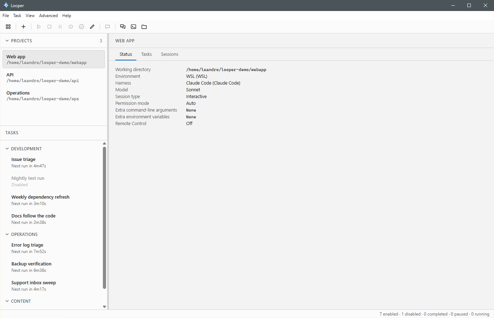
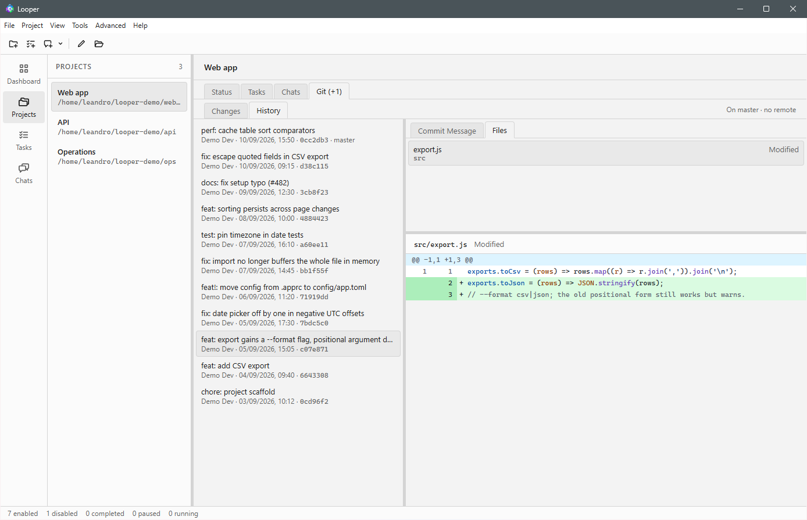
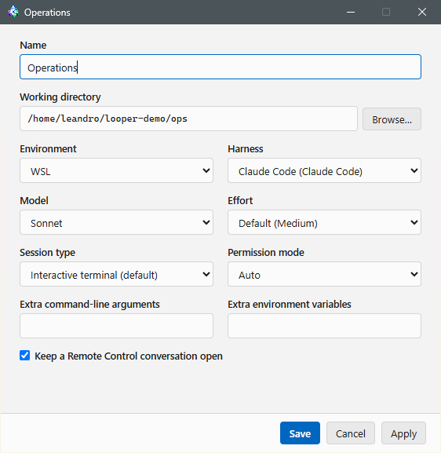

# Projects

A project is a folder you work in: your tasks run there, and your chats,
terminal sessions and Remote Control conversations open there. Each project
has an environment and agent settings (harness, session type, model, effort
and permission mode). Its tasks use them unless a task picks its own, and
its chats and terminal sessions start with the same harness, model, effort
and permission mode.

## Creating a project

You never have to create a project before a task. On the task editor's
General tab, leave **Project** on **New project** and pick the task's
working directory: saving the task creates the project for that folder,
named after it, with the task's environment and agent settings. A task saved with
the folder of an existing project joins that project.

To make a project with no tasks, for example a folder you only chat in, use
**File → New Project…**, or right-click the list on the Projects tab.

## The Projects tab

The main window's **Projects** tab lists every project with its folder on the
left, under the header **Projects** with their count, and shows the selected
project's view on the right ("No project selected." when none). Drag a project
to change the order, which the tray icon's menu follows too.

The list can group its projects. Right-click the list, or open **View → Group
Projects By**, and pick **None** (the default), **Folder** (the folder each
project's working directory is in), or **Harness** (the harness its chats and
terminal sessions start with). Each group has a header with its project count,
and the groups are listed by name; inside a group the projects keep your order.
While the list is grouped you can't drag projects to reorder them. The choice
is saved with the other View settings.

Selecting a project shows its view, and the
[toolbar](monitoring.md#the-toolbar) then has **Edit Project** and **Open
Folder** after its New buttons, which start a task, chat or terminal in the
project. The **Status** tab shows the project's settings and
whether it keeps a Remote Control conversation open. The **Tasks** tab lists
the tasks that run in the project, in the same kind of table as a task's
Runs tab, with each task's status, last run, its result and its details; double-click a task (or press Enter) to show it on the Tasks tab. The **Chats** tab lists the
project's chats, terminal sessions and Remote Control conversations, including
those that went on from one of its tasks' runs, in a table like a task's Runs
tab but without a Result column: double-click one for its run window, or right-click it to
go on with it in a chat or a terminal. When the project's folder is in a git
repository, a **Git** tab shows it (see [below](#the-git-tab)).

Right-clicking a project opens a menu with New Chat, New Terminal, New Task…,
Edit Project…, Open Working Directory and Delete Project. Double-clicking it
opens Edit Project. The **Project** menu in the menu bar has the same actions
(New Task in Project…, New Chat, New Terminal, Edit Project…, Open Folder,
Delete Project…) for the selected project, or the selected task's project. It shows on the
Dashboard, Projects and Tasks tabs, and it's greyed out while neither is
selected.

## The Git tab

When a project's folder is in a git repository, the project's view has a
**Git** tab, and so does the [activity
pane](monitoring.md#the-activity-pane) of the Chats tab and window for the project's
sessions. It shows the
repository and doesn't change it.

- **Changes** lists the uncommitted files, staged or not, with what happened to
  each (Modified, Added, Deleted, Renamed, Untracked, or Conflict) and whether
  it's staged. Selecting one shows its changes against the last commit.
- **History** lists the branch's commits, newest first, with their author,
  date, short id and the branches and tags on them. Selecting one shows its
  details in two tabs: **Commit Message** has the message, author, date and
  full id, and **Files** lists the files it changed, with what the selected
  file changed in the commit below the list. A merge shows what it brought into
  the branch.

Drag the divider between any two sections to resize them: the commits and the
selected commit, or a list of files and its changes. When the Files tab is too
short to show both, the changes move to a third tab, **Diff**, beside Files.
The same goes for the uncommitted files in the Chats window.

The tab's title counts the uncommitted files: "Git (+2 ~3 −1)" means 2 new, 3
changed (renamed and conflicted files included) and 1 deleted, and a count of
zero is left out. Beside the Changes and History tabs (at the bottom in the
Chats window), a line shows the branch and how far it is ahead of or behind
the remote branch it tracks, or "no remote" when it doesn't track one. While
Looper has the focus, the tab reads the changes again every 5 seconds while an
agent works in the project, and every minute when none does. It also reads them as soon as the agent's work
ends, and when you come back to the window a minute or more after it last
read them. It reads the history again when the changes change, or when you
come back after a minute. Right-click a file for Open File, Show in Folder and Copy Path, or
a commit for Copy Commit ID and Copy Subject.

Git runs in the project's environment, so a WSL project needs git installed in
its WSL distribution. Looper reads the repository without taking git's index
lock, so an agent's own git commands never wait on it.

## Editing a project

- **Name** — how the project shows on the Projects tab, in the tray menu, the
  Chats tab and window, and the Claude app for a Remote Control conversation. Left
  empty, it's the folder's name.
- **Working directory** — the project's folder, in the path style its
  environment expects. Browse… opens a picker scoped to the environment.
  Two projects can't have the same folder in the same environment.
- **Environment** and **Harness** — where the project's tasks and sessions
  run, and the agent CLI they run.
- **Model**, **Effort**, **Session type** and **Permission mode** — what
  the project's tasks run with, unless a task has its own agent settings.
  New chats and terminal sessions start with the same model, effort and
  permission mode; they're always interactive, so the session type is only
  for tasks.
- **Extra command-line arguments** — appended to the harness command line
  of every task's agent and every chat and terminal session in the project.
  A task's own arguments come after them.
- **Extra environment variables** — set for every step of the project's
  tasks and for its sessions. A task's own variables are added to them, and
  replace one with the same name.
- **Keep a Remote Control conversation open** — while
  [Remote Control](monitoring.md#remote-control) is on, a conversation in
  this project is always open in the Claude app, and another one opens once
  it's used and ends.

Saving a change applies it to the project's tasks right away: a task moves
with the project's folder, and follows its environment and agent settings
unless the task overrides them. A task that keeps one rolling conversation across
runs starts a new one, since a conversation can't move to another folder,
environment or harness.

## Tasks and their project

A task always runs in its project's folder. On its General tab, **Override
the project's environment** lets the task run in another environment that
uses the same kind of path, and on its Agent tab, **Override the project's
agent settings** lets it pick its own harness,
session type, model, effort and permission mode. Without those boxes
checked, the task follows the project. See [the task
editor](tasks.md#general).

To move a task to another project, pick that project on its General tab.

## Starting a chat from the tray

Right-click the tray icon and click a project: a new chat opens in it with the project's
harness, model and permission mode. It shows on the main window's Chats tab,
which comes forward, or in the [Chats window](monitoring.md#the-chats-window)
when that's open (see [the main window](monitoring.md#the-main-window)).
Double-clicking the tray icon shows the main window.

## Deleting a project

**Delete Project** asks first, and leaves the folder and its files as they
are. A project that still has tasks can't be deleted: move them to another
project or delete them first. Its past chats and terminal sessions stay in
the run history until their retention runs out.
