# Remote Access

Remote Access serves Looper from this computer to a browser on another
device: a phone, a tablet, or another computer. What you see there is Looper
itself, not a summary of it. Every window, menu, dialog and file picker works
as it does at the computer, so you can start a run, watch a terminal or answer
an agent from anywhere.

Remote Access is off until you turn it on, and it works only while Looper is
running on the computer.

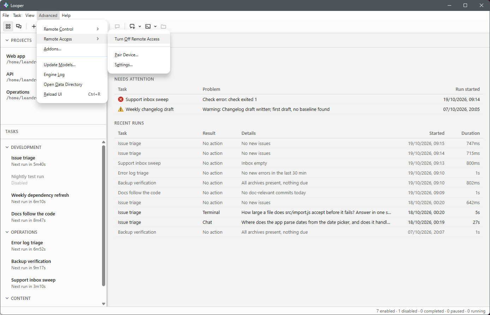

## Turning it on

**Advanced → Remote Access → Turn On Remote Access** starts it (the item then
reads **Turn Off Remote Access**) and keeps it on whenever Looper starts.
While it's on, the main window's status bar says **Remote Access enabled**.
**Advanced → Remote Access → Settings…** opens its window:

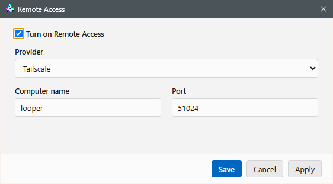

- **Turn on Remote Access** — the same switch as the menu item.
- **Name** — what paired devices call this computer: in **This Device**, in
  the browser tab's title and wherever Looper names the computer there. Left
  empty, it's the computer's own name in the operating system, which the field
  shows in grey.
- **Provider** — how other devices reach the computer: **Tailscale** or **This
  computer only** (see [below](#providers)).
- **Machine name** — Tailscale only. The computer's name on your tailnet and
  the start of the address, `looper` by default.
- **Port** — the port on this computer that Looper's server listens on. Until
  you save one, the window fills in a free port (the one in use, while Remote
  Access is on).

Changes to the provider, machine name and port apply when you save them, and
restart Remote Access if it's on. A new **Name** doesn't restart it, and
connected devices show it at once. If Remote Access
can't start, or stops working, a dialog says why.

## Providers

### Tailscale

Looper includes its own Tailscale client: the computer doesn't need the
Tailscale app, and Looper joins your tailnet as a device of its own, named by
**Machine name**. The phone or other device does need the Tailscale app,
signed in to the same tailnet.

1. In the Remote Access window, choose **Tailscale**, check **Turn on Remote
   Access** and save.
2. The first time, a dialog asks you to sign in to Tailscale. Click **Sign
   In…** and sign in with your Tailscale account in the browser. Looper
   remembers it. If you cancel the dialog, **Advanced → Remote Access → Sign In
   to Tailscale…** opens the same page.
3. Turn on HTTPS certificates for your tailnet, once: in the Tailscale admin
   console, on the **DNS** page. Without them an error dialog says so; turn
   Remote Access off and on again after.

The address is then `https://<machine name>.<tailnet>.ts.net`, which the Pair
Device window shows. It's reachable only from your tailnet, and only the
Tailscale account that signed in may connect, so another person on the tailnet
is refused.

**Advanced → Remote Access → Sign Out of Tailscale…** asks first, then forgets
the account, and Looper asks you to sign in again.

### This computer only

For trying Remote Access without Tailscale. The address is
`http://localhost:<port>`, and only a browser on this computer can open it.

## Pairing a device

A device must be paired before it can open Looper. **Advanced → Remote Access
→ Pair Device…** (or **Pair Device…** in the Paired Devices window) opens a
window with a QR code and an 8-character code. It's available while Remote
Access is running.

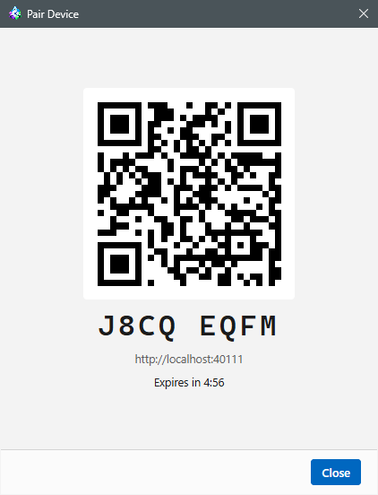

On the device, scan the QR code with the camera, or open the address and type
the code. The device's name is guessed from its browser; change it if you like,
then press **Pair**. The Pair Device window then says **Paired with** the name.

A code works once and for 5 minutes, and stops working after 5 wrong tries.
When it has expired, **New Code** makes another. Closing the window cancels the
code.

The device stays paired until it's removed: the browser keeps a cookie that
Looper checks on every connection, so use the same address again, and don't
clear the site's data.

## Paired devices

**Advanced → Remote Access → Paired Devices…** lists the paired devices, each
with whether it's connected now or when it was last used, and the provider it
was paired under. A device paired under one provider works only while that
provider is on.

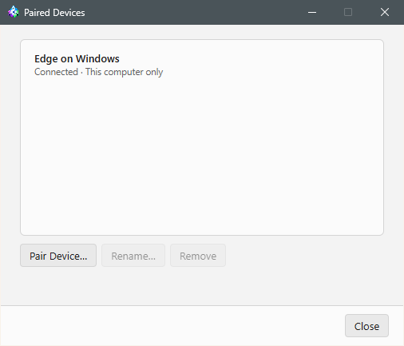

- **Pair Device…** opens the Pair Device window.

- **Rename…** (or double-click) changes a device's name.
- **Remove** asks first, then cuts the device off at once. It needs a new
  pairing code to connect again.

A device can also rename itself, with **Name** in **This Device** (**Device
name** on Android), and unpair itself: **This Device → Unpair This Device**. The Paired Devices window follows
either change at once.

## In a desktop browser

In a browser on another computer, the main window fills the page, with its
menu bar. Every other window opens as a dialog over it: drag it by its title
bar, resize it by its edges, and use the buttons on its title bar to minimize
it, maximize it (a window you can resize) or close it. Double-clicking the
title bar also maximizes it. A modal window blocks the window it opened over,
as it does at the computer.

A bar along the bottom lists the open windows, **Looper** (the main window)
first, with the one in front marked, and **This Device** at its end. Clicking
a window there brings it to the front, and brings back a minimized one.
Clicking the main window while a modal window is open minimizes the modal
window, which still blocks the main window; clicking the main window again, or
the modal window in the bar, brings it back.

The browser tab's title is the window in front and the computer's
[name](#turning-it-on).

Right-click opens context menus, and menu shortcuts work as at the computer,
shown next to each item. The browser keeps a few for itself (for example
Ctrl+N, Ctrl+T, Ctrl+W and Ctrl+Tab); choose those from the menu instead.

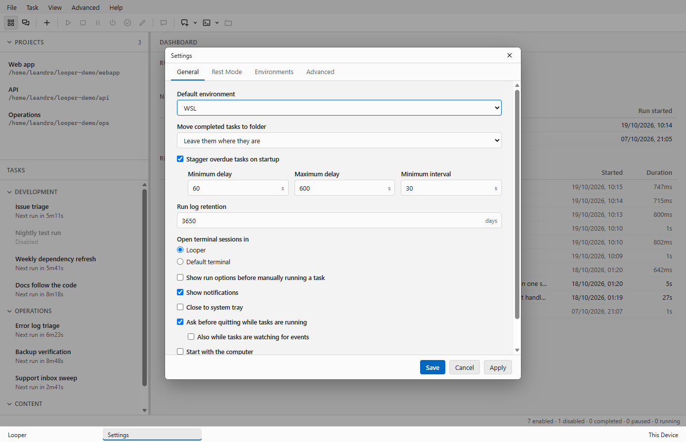

Each browser tab is its own connection with its own windows. If the connection
drops, the page says **Reconnecting…**, and a tab that comes back within two
minutes finds its windows as it left them.

### This Device

**This Device** at the end of the bar opens a window with:

- **Name** — this device's name, as the computer's Paired Devices window lists
  it.
- **Computer** — the computer it's paired with.
- **Notifications** — see [Notifications](#notifications).
- **Unpair This Device** — asks first, then unpairs it at once.

**Save** keeps the new name and the Notifications choice; **Cancel** leaves
both as they were.

### Files

A file picker has two tabs:

- **This Computer** browses the computer's folders, with **New Folder**. Looper
  remembers the last tab and folder you used.
- **This Device** sends a file from the device to the computer: **Choose
  File…** opens the device's own picker, and Looper uploads what you choose.

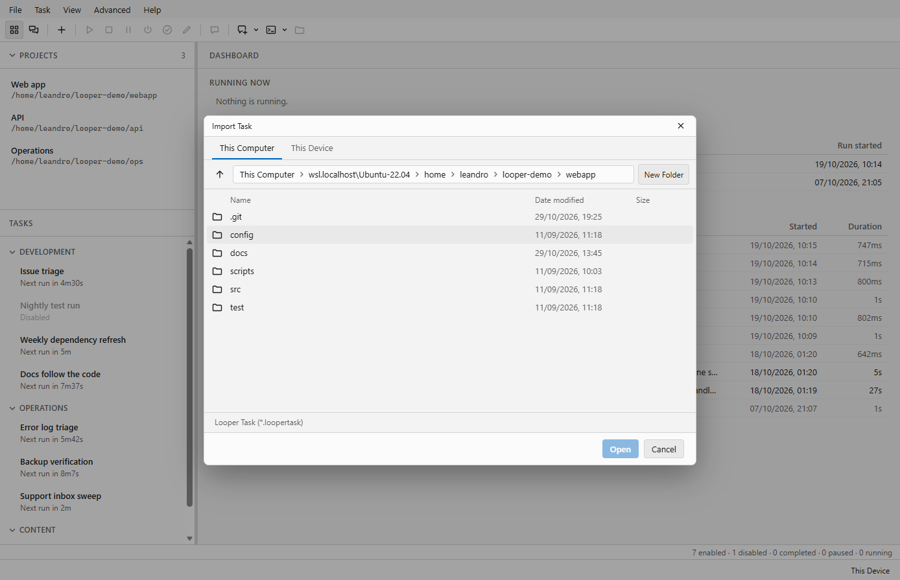

A picker that chooses a folder only offers **This Computer**. **Save As** works
the same way: save in a folder on the computer, or under **This Device**, where
only the file name is needed and the file is downloaded to the device.

Open Working Directory and Show in Folder, used from the device, list the
folder's files in a window, with **Download** for the selected file and **Open
on Computer**, which opens it with its default app on the computer. A file
asks **Open on Computer** or **Download**.

## On a phone or tablet

An iPhone or iPad gets Looper in iOS's style and an Android device in
Android's, with one window on screen at a time.

| | Dashboard | A task | More menu |
|---|---|---|---|
| **iPhone** | 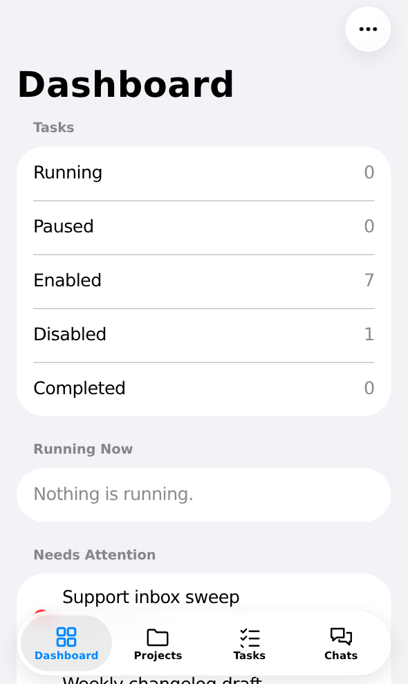 | 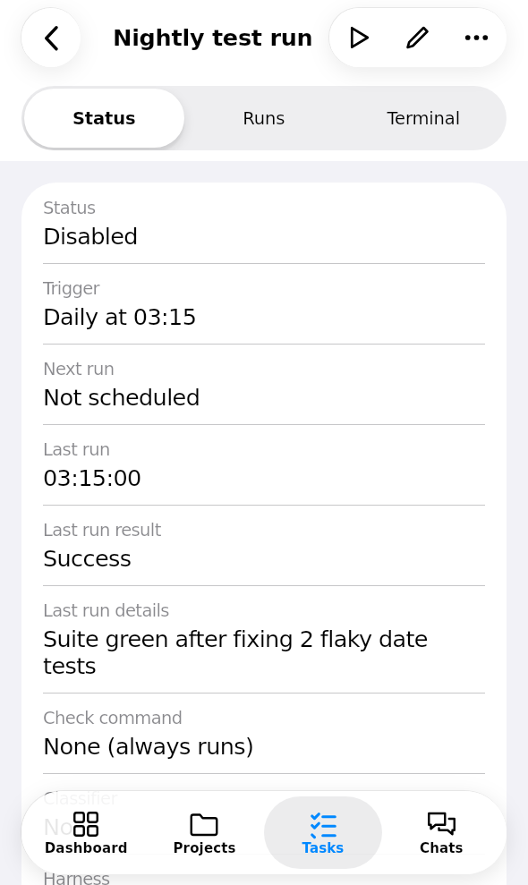 | 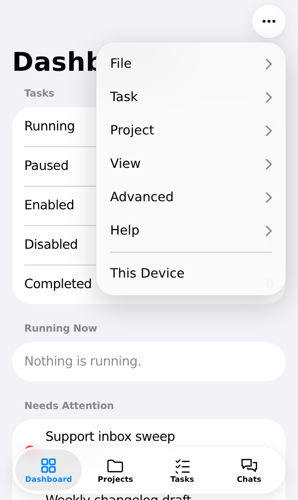 |
| **Android** | 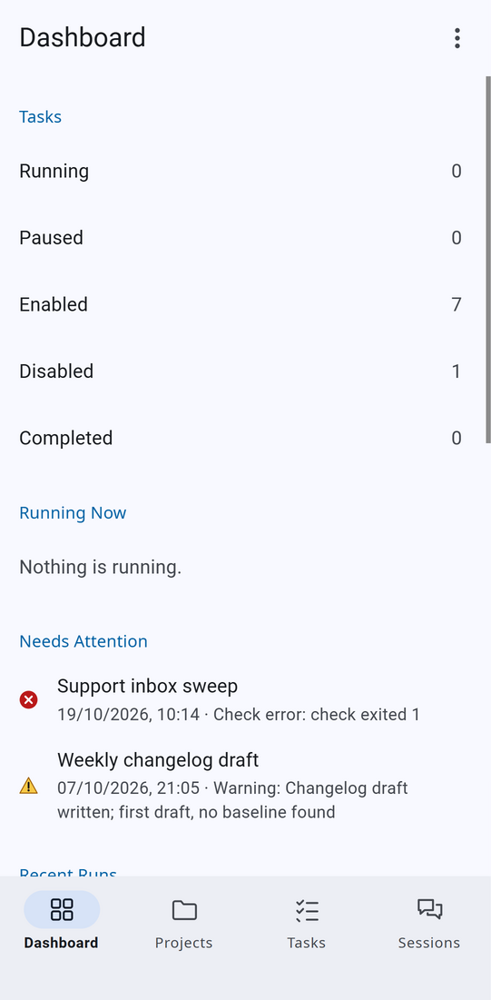 | 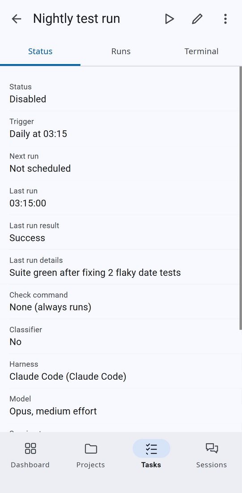 | 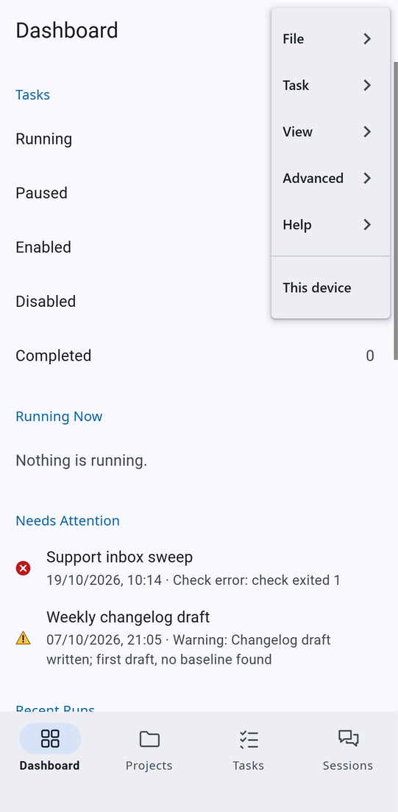 |

- The main window has tabs along the bottom: **Dashboard**, **Projects**,
  **Tasks** and **Chats**. Selecting a task or a project opens its screen
  over the list; each tab keeps its own screens, and tapping the tab you're on
  goes back to its list.
- The menu bar is behind **More** (**⋯** on an iPhone, **⋮** on Android): File,
  Task, View, Advanced and Help, and **This Device**.
- Other windows open as full screens that you leave with **Back** (**‹** on an
  iPhone, **←** on Android), or as sheets. On an iPhone you close a sheet with
  **✕** or drag it down; on Android, **✕** or a tap outside it closes it.
- **Back** also answers the back gesture or button of the phone, and on an
  iPhone a swipe from the left edge.
- A long press (half a second) opens the context menu.
- A terminal has a key row above the keyboard: **Esc**, **Tab**, a **Ctrl** that
  holds for the next key, the arrows, and `|`, `~`, `/` and `-`, with **A−**
  and **A+** for the text size.

To open Looper without the browser's bars, add it to the Home Screen: in Safari
on an iPhone, Share → **Add to Home Screen**; in Chrome on Android, **Install
app** or **Add to Home screen** in the menu.

## Notifications

Looper's own notifications also reach paired devices:

- While a device has a Looper tab open, each notification appears there as a
  toast. Tap it to open the task's run.
- With **Notifications** on in **This Device** (on a phone, **More → This
  Device**), a device that isn't looking at Looper gets them as system
  notifications too, even when Looper isn't open there. The browser asks for
  permission when you turn it on.

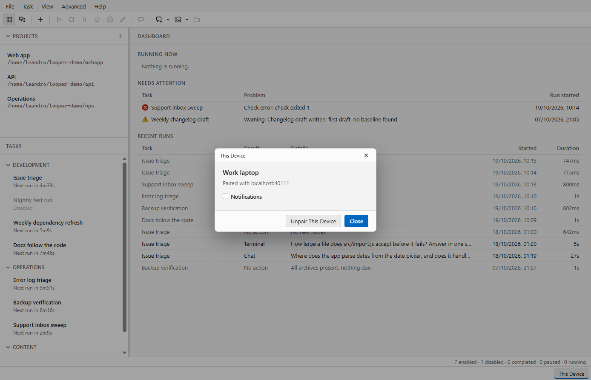

They are the notifications Looper shows at the computer, so the same settings
decide which ones come: **Show notifications** in Settings and each task's
[Notifications tab](tasks.md#notifications). A system notification goes only
when no Looper window has the focus on the computer, and a device with a
Looper tab on screen gets just the toast. A session waiting for you (a
question, or a finished turn) sends a system notification as well, and tapping
it opens the session in the Chats window; turning **Show notifications** off
silences these too.

On an iPhone, system notifications need Looper added to the Home Screen first;
**This Device** says so until it is. In a browser that doesn't support them, or
where you blocked them for Looper, the switch stays disabled.

## Security

- A paired device can do anything Looper can on the computer: run and edit
  tasks, open terminals, browse and download the computer's files. Pairing is
  the gate, so pair only devices you trust, and remove one you lose.
- Looper's server listens on 127.0.0.1 only. Tailscale is what makes it
  reachable, and only on your tailnet, over HTTPS, and only for the account the
  computer is signed in as. A device still needs its pairing on top.
- A pairing code is random, works once, expires in 5 minutes and locks after 5
  wrong tries.
- Removing a device, turning Remote Access off or quitting Looper closes the
  connections at once.

## Troubleshooting

- **An error dialog about HTTPS certificates.** Turn on HTTPS certificates for
  your tailnet in the Tailscale admin console, on the DNS page, then turn
  Remote Access off and on again.
- **An error dialog says the port is in use.** Another program has the port.
  Set **Port** to another number.
- **Looper asks to sign in to Tailscale again.** Click **Sign In…**. It asks
  again after **Sign Out of Tailscale…**.
- **A device says it isn't paired.** Its pairing was removed, or it was paired
  under the other provider, or the browser lost its cookie. Pair it again with a
  new code. Open the same address it was paired at: another name, or the
  computer's address instead of Tailscale's, is a different site to the browser.
- **The pairing page says the code is wrong or has expired.** Make a new code
  in the Pair Device window and type it again.
- **A phone can't reach the address.** The phone needs the Tailscale app, signed
  in to the same tailnet, and Looper needs to be running on the computer.
