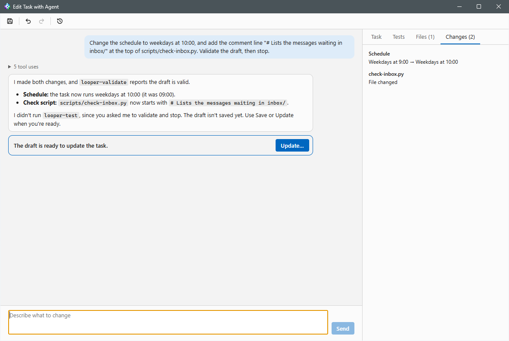

# Building a task with an agent

Instead of filling in the task editor yourself, you can describe the task in
a conversation and let an agent build it: **File → New Task with Agent…**
for a new task, or **Edit with Agent…** (Task menu and the task's context
menu) to change an existing one. The agent writes the task's scripts, keeps
the task's definition up to date, and tests that the task can reach what it
needs. Nothing is stored until you save: with Save on the window's toolbar,
or by reviewing the draft in the normal task editor and saving it there.

## Starting

**New Task with Agent…** opens a small window with the agent's
**Environment**, **Harness** (Claude Code or Codex only), **Model**,
**Effort**, and the task's **Working directory**. Start turns the window into
the conversation. **Edit with Agent…** skips that window: it uses the task's
own environment, harness, model, effort and working directory. A task has at
most one Edit Task with Agent window; Edit with Agent on it again brings that
window forward.

The task keeps running on its schedule while you edit it with an agent. A
run that starts in the meantime uses the scripts as they are on disk at that
moment, and the definition as it was last saved.

## The conversation

Type what the task should do and press Enter (Shift+Enter starts a new
line). The agent's replies show in full. The tool calls between two replies
(commands it ran, files it wrote) show as one line, such as "4 tool uses";
expand it to list the calls, and expand a call to see its input and result.

The agent runs in the task's working directory, so it can read the project
and test the task from where it will run. It runs without the project's or
your own configuration: for Claude Code, without CLAUDE.md, hooks, skills,
plugins, MCP servers and the permission rules of every settings file
(`--safe-mode --setting-sources=`); for Codex, in a Codex home of its own
that holds only a copy of your login, so your `config.toml`,
`AGENTS.md` and rules stay out, as does the project's `AGENTS.md`. When Codex
refreshes the login there, Looper copies it back to your own Codex home. The
agent reads the project's instructions as files to learn the project, but
they don't apply to it. It runs in Auto permission mode, and the
conversation isn't saved to your Claude Code or Codex history.

The agent may only create and change the task's own files (scripts in the
working directory). It changes them in place, so a run that starts before you
save already uses them.

Closing the window with unsaved changes asks whether to save them. **Save**
stores the draft, **Don't Save** puts every file the agent changed back the
way it was at the last save (a file it created is deleted), and **Cancel**
keeps the window open. Closing the main window or quitting Looper asks the
same for each open window with an agent. Closing ends the session and
deletes the conversation's working files.

## The draft panel

The panel next to the conversation has these tabs:

- **Task**: the task as the agent has it so far, in the task editor's terms:
  its name, when it runs ("Weekdays at 9:00"), the working directory, the
  check command, the agent's harness, model, effort, permission mode and
  session type, the prompt, and last the validation (Valid, or each
  problem with the definition).
- **Tests**: every test the agent ran, with its result.
- **Files**: the files the agent created or changed.
- **Changes** (once the task exists): each field that differs from the
  saved task, with its old and new value where they fit on a line.

## Saving, Undo and Redo

Once the draft is valid and differs from the saved task, a card under the
agent's last reply offers **Create…** (**Update…** once the task exists),
which opens the task editor prefilled with the draft for a last review.

The toolbar at the top of the window has:

- **Save** (Ctrl+S): store the draft as it is, without the editor.
- **Undo** (Ctrl+Z) and **Redo** (Ctrl+Y): take back the agent's last change
  to the draft and the task's files, one reply at a time, or put it back.
  Nothing is saved until you click Save, and your next message tells the
  agent its work changed. A new change after Undo replaces what Redo could
  have put back.
- **Version History**: the task's [version history](tasks.md#version-history)
  window. While Edit Task with Agent is open on the task, its **Edit with
  Agent** button replaces Restore: the conversation continues from that
  version's definition and files, unsaved, and Undo goes back to the work
  from before.

Either way of saving records the version as the agent's, together with the
files the agent wrote; saving a loaded version unchanged records it as a
restore of that version. You can keep talking to the agent afterwards and
save again.

## Tests

The agent tests the task with two commands Looper puts on its PATH:

- **`looper-test check`** runs the draft's check exactly as a scheduled run
  would: same environment, shell, variables and working directory. It sets
  `LOOPER_TEST=1`, so a check that saves a cursor (such as the last id it
  saw) can skip saving it and leave the first real run its events.
- **`looper-test agent <file>`** shows what the task's agent will be allowed
  to do. The agent first writes a list of read-only operations the task
  needs ("run `gh auth status`", "read one issue of owner/repo"). Looper then
  starts a separate headless session with the task's harness, model,
  permission mode, arguments and variables, and the project's full
  configuration (hooks, permission rules, MCP servers), and gives it only
  that list. The session reports each operation as allowed or not, and
  Looper shows the list in the panel.

The access test never sees the task's prompt, so it can't do the task's
work. It's told to perform only the listed operations, to check write access
to an outside service by the credential's scope instead of by writing, and
to limit itself to temp files it deletes. The session gets no task id and
can't end or complete the task.

## Terminal view

**Settings → Advanced → Show conversations with the agent in** can show
the harness's own interactive terminal instead of the chat view. The panel
and the toolbar work the same way; with no chat there is no Create…/Update…
card, so save with Save. With no replies to count, Undo takes back the
agent's changes up to the last pause of 3 seconds, and the agent isn't told
about Undo/Redo. With Claude Code, Looper can't see the
agent's tool calls in the terminal view, so the Files tab stays empty; the
version history still records the scripts the task's commands refer to.
With Codex, Looper reads the changed files from Codex's session files.
